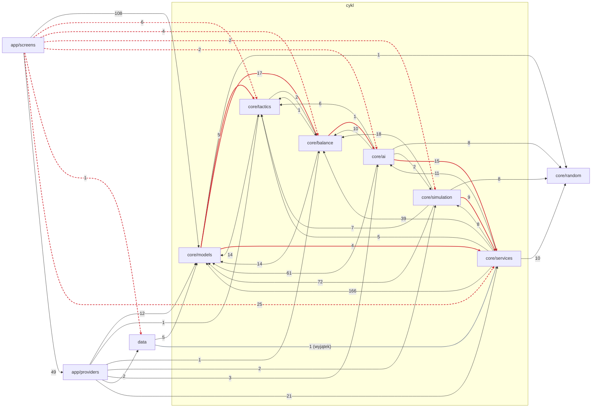
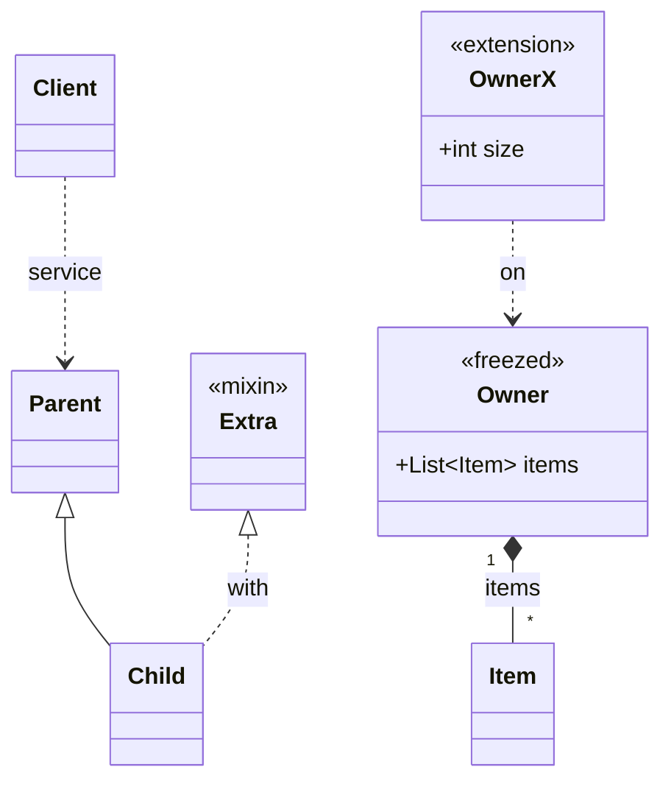

<!-- Generated by scripts/gen_class_diagrams.dart. Do not edit by hand. -->

# Architektura

Diagramy w tym katalogu powstają ze skryptu `scripts/gen_class_diagrams.dart`, który czyta AST pakietem `analyzer`. Pomija `*.g.dart`, `*.freezed.dart` i `lib/l10n/generated`.

## Przegląd pakietów

Warstwy są numerowane od dołu. Pakiet z wyższym numerem może importować pakiet z niższym. Import w drugą stronę jest ruchem w górę.

| Pakiet | Warstwa |
| --- | --- |
| `core/models` | 0 |
| `core/random` | 0 |
| `core/tactics` | 1 |
| `core/balance` | 1 |
| `core/simulation` | 2 |
| `core/ai` | 3 |
| `data` | 4 |
| `core/services` | 5 |
| `app/providers` | 6 |
| `app/screens` | 7 |

Kolor krawędzi pochodzi z `EdgeKind`:

- Zwykła krawędź: import w dół warstwy albo w obrębie tej samej warstwy.
- Ciągła czerwień: pakiet z niższej warstwy importuje pakiet z wyższej.
- Przerywana czerwień: `app/screens` importuje pakiet inny niż `app/providers` i `core/models`.
- Szara krawędź: dozwolony wyjątek z listy `allowedExceptions`.

Liczba na strzałce to liczba dyrektyw `import`. `export` oraz importy warunkowe nie wchodzą do licznika. Import wewnątrz jednego pakietu też nie.

### Silnie spójne składowe

- `core/ai`, `core/balance`, `core/models`, `core/services`, `core/simulation`, `core/tactics`

### Oznaczone krawędzie

- `core/models` → `core/tactics` (5, warstwa w górę)
- `core/models` → `core/balance` (17, warstwa w górę)
- `core/models` → `core/services` (4, warstwa w górę)
- `core/balance` → `core/ai` (1, warstwa w górę)
- `core/simulation` → `core/services` (9, warstwa w górę)
- `core/ai` → `core/services` (15, warstwa w górę)
- `data` → `core/services` (1, dozwolony wyjątek) — adapter w data implementuje interfejs repozytorium zadeklarowany w core/services
- `app/screens` → `core/tactics` (6, omija providers)
- `app/screens` → `core/balance` (4, omija providers)
- `app/screens` → `core/simulation` (2, omija providers)
- `app/screens` → `core/ai` (2, omija providers)
- `app/screens` → `data` (1, omija providers)
- `app/screens` → `core/services` (25, omija providers)



<details>
<summary>Wszystkie krawędzie</summary>

| Z | Do | Importy | Oznaczenie | Przykład |
| --- | --- | --- | --- | --- |
| `core/models` | `core/random` | 1 | zgodna z warstwą | `lib/core/models/seed_data_generator.dart -> package:new_football/core/random/seeds.dart` |
| `core/models` | `core/tactics` | 5 | warstwa w górę | `lib/core/models/match_models.dart -> package:new_football/core/tactics/tactics_setup.dart` |
| `core/models` | `core/balance` | 17 | warstwa w górę | `lib/core/models/contract.dart -> package:new_football/core/balance/finance_balance.dart` |
| `core/models` | `core/services` | 4 | warstwa w górę | `lib/core/models/seed_data_generator.dart -> package:new_football/core/services/contract_period_service.dart` |
| `core/tactics` | `core/models` | 14 | zgodna z warstwą | `lib/core/tactics/formation_layout.dart -> package:new_football/core/models/enums.dart` |
| `core/tactics` | `core/balance` | 2 | zgodna z warstwą | `lib/core/tactics/substitute_candidates.dart -> package:new_football/core/balance/balance_config.dart` |
| `core/balance` | `core/models` | 14 | zgodna z warstwą | `lib/core/balance/ai_balance.dart -> package:new_football/core/models/enums.dart` |
| `core/balance` | `core/tactics` | 1 | zgodna z warstwą | `lib/core/balance/matchday_balance.dart -> package:new_football/core/tactics/tactics_setup.dart` |
| `core/balance` | `core/ai` | 1 | warstwa w górę | `lib/core/balance/ai_balance.dart -> package:new_football/core/ai/ai_evaluation_models.dart` |
| `core/simulation` | `core/models` | 72 | zgodna z warstwą | `lib/core/simulation/effective_attributes.dart -> package:new_football/core/models/enums.dart` |
| `core/simulation` | `core/random` | 8 | zgodna z warstwą | `lib/core/simulation/duel_resolver.dart -> package:new_football/core/random/match_random.dart` |
| `core/simulation` | `core/tactics` | 7 | zgodna z warstwą | `lib/core/simulation/effective_attributes.dart -> package:new_football/core/tactics/position_role_fit.dart` |
| `core/simulation` | `core/balance` | 18 | zgodna z warstwą | `lib/core/simulation/duel_resolver.dart -> package:new_football/core/balance/balance_config.dart` |
| `core/simulation` | `core/services` | 9 | warstwa w górę | `lib/core/simulation/effective_attributes.dart -> package:new_football/core/services/team_management_service.dart` |
| `core/ai` | `core/models` | 61 | zgodna z warstwą | `lib/core/ai/ai_contract_market_service.dart -> package:new_football/core/models/contract_market_models.dart` |
| `core/ai` | `core/random` | 8 | zgodna z warstwą | `lib/core/ai/ai_contract_market_service.dart -> package:new_football/core/random/seeds.dart` |
| `core/ai` | `core/tactics` | 6 | zgodna z warstwą | `lib/core/ai/ai_matchday_models.dart -> package:new_football/core/tactics/tactics_setup.dart` |
| `core/ai` | `core/balance` | 10 | zgodna z warstwą | `lib/core/ai/ai_contract_market_service.dart -> package:new_football/core/balance/balance_config.dart` |
| `core/ai` | `core/simulation` | 2 | zgodna z warstwą | `lib/core/ai/ai_matchday_service.dart -> package:new_football/core/simulation/effective_attributes.dart` |
| `core/ai` | `core/services` | 15 | warstwa w górę | `lib/core/ai/ai_contract_market_service.dart -> package:new_football/core/services/contract_service.dart` |
| `data` | `core/models` | 5 | zgodna z warstwą | `lib/data/save_management_repository_adapter.dart -> package:new_football/core/models/game_save.dart` |
| `data` | `core/services` | 1 | dozwolony wyjątek | `lib/data/save_management_repository_adapter.dart -> package:new_football/core/services/save_management_repository.dart` |
| `core/services` | `core/models` | 166 | zgodna z warstwą | `lib/core/services/calendar_event_registry.dart -> package:new_football/core/models/draft_models.dart` |
| `core/services` | `core/random` | 10 | zgodna z warstwą | `lib/core/services/contract_market_service.dart -> package:new_football/core/random/seeds.dart` |
| `core/services` | `core/tactics` | 5 | zgodna z warstwą | `lib/core/services/cohesion_service.dart -> package:new_football/core/tactics/position_role_fit.dart` |
| `core/services` | `core/balance` | 39 | zgodna z warstwą | `lib/core/services/calendar_event_registry.dart -> package:new_football/core/balance/balance_config.dart` |
| `core/services` | `core/simulation` | 8 | zgodna z warstwą | `lib/core/services/day_simulator.dart -> package:new_football/core/simulation/match_context_factory.dart` |
| `core/services` | `core/ai` | 11 | zgodna z warstwą | `lib/core/services/contract_market_service.dart -> package:new_football/core/ai/ai_contract_market_service.dart` |
| `app/providers` | `core/models` | 12 | zgodna z warstwą | `lib/app/providers/development_provider.dart -> package:new_football/core/models/development_snapshot.dart` |
| `app/providers` | `core/tactics` | 1 | zgodna z warstwą | `lib/app/providers/game_provider.dart -> package:new_football/core/tactics/lineup_slots.dart` |
| `app/providers` | `core/balance` | 1 | zgodna z warstwą | `lib/app/providers/game_provider.dart -> package:new_football/core/balance/balance_config.dart` |
| `app/providers` | `core/simulation` | 2 | zgodna z warstwą | `lib/app/providers/game_provider.dart -> package:new_football/core/simulation/match_context_factory.dart` |
| `app/providers` | `core/ai` | 3 | zgodna z warstwą | `lib/app/providers/game_provider.dart -> package:new_football/core/ai/ai_matchday_service.dart` |
| `app/providers` | `data` | 2 | zgodna z warstwą | `lib/app/providers/game_provider.dart -> package:new_football/data/save_repository.dart` |
| `app/providers` | `core/services` | 21 | zgodna z warstwą | `lib/app/providers/game_provider.dart -> package:new_football/core/services/calendar_event_registry.dart` |
| `app/screens` | `core/models` | 108 | zgodna z warstwą | `lib/app/screens/calendar_screen.dart -> package:new_football/core/models/league_state.dart` |
| `app/screens` | `core/tactics` | 6 | omija providers | `lib/app/screens/matchday_screen.dart -> package:new_football/core/tactics/tactics_setup.dart` |
| `app/screens` | `core/balance` | 4 | omija providers | `lib/app/screens/development_screen.dart -> package:new_football/core/balance/staff_balance.dart` |
| `app/screens` | `core/simulation` | 2 | omija providers | `lib/app/screens/matchday_screen.dart -> package:new_football/core/simulation/match_engine.dart` |
| `app/screens` | `core/ai` | 2 | omija providers | `lib/app/screens/matchday_screen.dart -> package:new_football/core/ai/ai_matchday_models.dart` |
| `app/screens` | `data` | 1 | omija providers | `lib/app/screens/inbox_screen.dart -> package:new_football/data/save_repository.dart` |
| `app/screens` | `core/services` | 25 | omija providers | `lib/app/screens/calendar_screen.dart -> package:new_football/core/services/calendar_event_registry.dart` |
| `app/screens` | `app/providers` | 49 | zgodna z warstwą | `lib/app/screens/calendar_screen.dart -> package:new_football/app/providers/game_provider.dart` |

</details>

## Legenda

### Przegląd

- Strzałka `A --> B` oznacza, że pliki pakietu A importują pliki pakietu B.
- Etykieta to liczba dyrektyw `import`.
- Ramka `subgraph` z etykietą `cykl` grupuje silnie spójną składową. Krawędzie w dół wewnątrz ramki zostają w zwykłym stylu.
- Ciągła czerwień: pakiet z niższej warstwy importuje pakiet z wyższej.
- Przerywana czerwień: `app/screens` importuje pakiet inny niż `app/providers` i `core/models`.
- Szara krawędź: dozwolony wyjątek z listy `allowedExceptions`.
- Wyjątek `data` → `core/services`: adapter w data implementuje interfejs repozytorium zadeklarowany w core/services.

### Diagram klas

- `<<freezed>>` — klasa z adnotacją `@freezed` / `@Freezed` albo z `with _$…`.
- `<<mixin>>`, `<<extension>>`, `<<enumeration>>`, `<<extensionType>>` — rodzaj deklaracji.
- `+` oznacza składową publiczną. `$` na końcu linii oznacza składową statyczną.
- Typy generyczne są zapisane jako `List~Player~`. Znaki `<` i `>` rozbijają parser Mermaida na GitHubie.
- `<|--` to `extends`.
- `<|..` to `implements`, `with` albo ograniczenie `on` mixinu. Etykieta mówi, który z tych trzech przypadków.
- `*--` to kompozycja przez typ pola. `"*"` oznacza pole `List`, `Set`, `Iterable` albo `Map`. `"0..1"` oznacza pole nullable. `"1"` oznacza pole wymagane.
- `..>` to zależność przez parametr konstruktora albo typ `on` extension.
- Pominięte są operatory oraz metody `copyWith`, `toJson`, `fromJson`, `hashCode` i `toString`.
- Pole bez adnotacji typu jest zapisane samą nazwą, na przykład `+currentVersion$`.
- Krawędź powstaje tylko wtedy, gdy oba typy są na tym samym diagramie.
- Stałe enuma, pola i metody są posortowane alfabetycznie.



## Pliki i regeneracja

### Pliki

- `docs/architecture/README.md` — ten przegląd, legenda i instrukcja.
- `scripts/gen_class_diagrams.dart` — generator. Mapa grup to `groups`, mapa stron to `pages`.
- `scripts/class_diagram_logic.dart` — czyste funkcje używane przez generator i testy.
- `docs/architecture/models.md` — Modele domenowe.
- `docs/architecture/services.md` — Serwisy.
- `docs/architecture/simulation.md` — Symulacja i taktyka.
- `docs/architecture/ai.md` — Sztuczna inteligencja.
- `docs/architecture/balance.md` — Balans.
- `docs/architecture/persistence.md` — Trwałość.
- `docs/architecture/app.md` — Aplikacja.

### Diagramy

#### Liga, sezon i tabela (`models.league`, 32 typy)

Plik: `docs/architecture/models.md`.

- `lib/core/models/league_state.dart`
- `lib/core/models/season.dart`
- `lib/core/models/season_awards.dart`
- `lib/core/models/season_history.dart`
- `lib/core/models/standing.dart`
- `lib/core/models/league_strength.dart`
- `lib/core/models/playoff_bracket.dart`
- `lib/core/models/play_in_models.dart`
- `lib/core/models/lottery_models.dart`
- `lib/core/models/lottery_result.dart`
- `lib/core/models/game_save.dart`
- `lib/core/models/save_record.dart`
- `lib/core/models/enums.dart`

#### Zawodnik, drużyna i sztab (`models.squad`, 40 typów)

Plik: `docs/architecture/models.md`.

- `lib/core/models/player.dart`
- `lib/core/models/player_attributes.dart`
- `lib/core/models/field_player_attributes.dart`
- `lib/core/models/goalkeeper_attributes.dart`
- `lib/core/models/assigned_role.dart`
- `lib/core/models/team.dart`
- `lib/core/models/staff.dart`
- `lib/core/models/injury.dart`
- `lib/core/models/scouting.dart`
- `lib/core/models/enums.dart`

#### Kontrakty, wymiany i draft (`models.market`, 34 typy)

Plik: `docs/architecture/models.md`.

- `lib/core/models/contract.dart`
- `lib/core/models/contract_market_models.dart`
- `lib/core/models/contract_negotiation.dart`
- `lib/core/models/trade_models.dart`
- `lib/core/models/draft_class.dart`
- `lib/core/models/draft_pick.dart`
- `lib/core/models/draft_state.dart`
- `lib/core/models/prospect.dart`
- `lib/core/models/enums.dart`

#### Mecz, wiadomości i zdarzenia (`models.match`, 39 typów)

Plik: `docs/architecture/models.md`.

- `lib/core/models/match_models.dart`
- `lib/core/models/match_state.dart`
- `lib/core/models/message.dart`
- `lib/core/models/player_event_state.dart`
- `lib/core/models/team_event_state.dart`
- `lib/core/models/enums.dart`

#### Sezon i kalendarz (`services.calendar`, 24 typy)

Plik: `docs/architecture/services.md`.

- `lib/core/services/calendar_event_registry.dart`
- `lib/core/services/calendar_service.dart`
- `lib/core/services/schedule_generator.dart`
- `lib/core/services/season_service.dart`
- `lib/core/services/season_awards.dart`
- `lib/core/services/season_draft.dart`
- `lib/core/services/season_fixtures.dart`
- `lib/core/services/season_lottery.dart`
- `lib/core/services/season_offseason_events.dart`
- `lib/core/services/season_play_in.dart`
- `lib/core/services/season_playoffs.dart`
- `lib/core/services/season_post_match.dart`
- `lib/core/services/season_rollover.dart`
- `lib/core/services/season_scouting.dart`
- `lib/core/services/lottery_service.dart`

#### Potok dnia (`services.day`, 21 typów)

Plik: `docs/architecture/services.md`.

- `lib/core/services/day_pipeline.dart`
- `lib/core/services/day_simulation_result.dart`
- `lib/core/services/day_simulator.dart`
- `lib/core/services/day_match_result_application.dart`
- `lib/core/services/day_round_resolution.dart`
- `lib/core/services/day_weekly_boundary.dart`
- `lib/core/services/day_world_updates.dart`
- `lib/core/services/simulation_worker.dart`

#### Rynek kontraktów (`services.market`, 26 typów)

Plik: `docs/architecture/services.md`.

- `lib/core/services/contract_market_service.dart`
- `lib/core/services/contract_market_ai_bridge.dart`
- `lib/core/services/contract_market_draft_rights.dart`
- `lib/core/services/contract_market_finalization.dart`
- `lib/core/services/contract_market_helpers.dart`
- `lib/core/services/contract_market_player_offers.dart`
- `lib/core/services/contract_market_resolution.dart`
- `lib/core/services/contract_market_rfa.dart`
- `lib/core/services/contract_market_signing.dart`
- `lib/core/services/contract_market_staff_offers.dart`
- `lib/core/services/contract_service.dart`
- `lib/core/services/contract_period_service.dart`
- `lib/core/services/negotiation_rules.dart`
- `lib/core/services/negotiation_service.dart`
- `lib/core/services/staff_service.dart`

#### Wymiany i draft (`services.trades`, 19 typów)

Plik: `docs/architecture/services.md`.

- `lib/core/services/trade_service.dart`
- `lib/core/services/draft_service.dart`
- `lib/core/services/draft_trade_service.dart`
- `lib/core/services/salary_cap_service.dart`
- `lib/core/services/mock_draft_service.dart`
- `lib/core/services/prospect_service.dart`

#### Zdarzenia i wiadomości (`services.events`, 23 typy)

Plik: `docs/architecture/services.md`.

- `lib/core/services/player_event_service.dart`
- `lib/core/services/player_event_decisions.dart`
- `lib/core/services/player_event_helpers.dart`
- `lib/core/services/player_event_messages.dart`
- `lib/core/services/player_event_triggers.dart`
- `lib/core/services/team_event_service.dart`
- `lib/core/services/team_event_decisions.dart`
- `lib/core/services/team_event_helpers.dart`
- `lib/core/services/team_event_messages.dart`
- `lib/core/services/team_event_promises.dart`
- `lib/core/services/team_event_triggers.dart`
- `lib/core/services/message_service.dart`
- `lib/core/services/message_text_service.dart`
- `lib/core/services/development_service.dart`
- `lib/core/services/discipline_service.dart`
- `lib/core/services/injury_service.dart`

#### Silnik meczu (`simulation.engine`, 18 typów)

Plik: `docs/architecture/simulation.md`.

- `lib/core/simulation/match_engine.dart`
- `lib/core/simulation/match_bootstrap.dart`
- `lib/core/simulation/live_match_state.dart`
- `lib/core/simulation/matchday_runtime.dart`
- `lib/core/simulation/pre_match_validator.dart`
- `lib/core/simulation/match_context_factory.dart`
- `lib/core/simulation/match_context_effects.dart`
- `lib/core/simulation/match_message_emitter.dart`

#### Rozstrzygnięcia akcji (`simulation.resolvers`, 24 typy)

Plik: `docs/architecture/simulation.md`.

- `lib/core/simulation/duel_resolver.dart`
- `lib/core/simulation/goalkeeper_resolver.dart`
- `lib/core/simulation/shot_resolver.dart`
- `lib/core/simulation/shot_models.dart`
- `lib/core/simulation/sequence_resolver.dart`
- `lib/core/simulation/sequence_chain_resolver.dart`
- `lib/core/simulation/set_piece_resolver.dart`
- `lib/core/simulation/match_incident_resolver.dart`
- `lib/core/simulation/match_stats.dart`

#### Oceny i taktyka (`simulation.tactics`, 21 typów)

Plik: `docs/architecture/simulation.md`.

- `lib/core/simulation/effective_attributes.dart`
- `lib/core/simulation/unit_ratings.dart`
- `lib/core/simulation/team_shape.dart`
- `lib/core/tactics/tactics_setup.dart`
- `lib/core/tactics/formation_layout.dart`
- `lib/core/tactics/lineup_slots.dart`
- `lib/core/tactics/player_sort.dart`
- `lib/core/tactics/position_group.dart`
- `lib/core/tactics/position_role_fit.dart`
- `lib/core/tactics/substitute_candidates.dart`

#### Ocena składu i aktywów (`ai.evaluation`, 13 typów)

Plik: `docs/architecture/ai.md`.

- `lib/core/ai/ai_evaluation_models.dart`
- `lib/core/ai/ai_evaluation_context.dart`
- `lib/core/ai/ai_evaluation_service.dart`

#### Decyzje AI (`ai.decisions`, 28 typów)

Plik: `docs/architecture/ai.md`.

- `lib/core/ai/ai_matchday_models.dart`
- `lib/core/ai/ai_matchday_service.dart`
- `lib/core/ai/ai_draft_models.dart`
- `lib/core/ai/ai_draft_service.dart`
- `lib/core/ai/ai_trade_models.dart`
- `lib/core/ai/ai_trade_service.dart`
- `lib/core/ai/ai_contract_market_service.dart`
- `lib/core/ai/ai_roster_management_service.dart`
- `lib/core/ai/team_ai_service.dart`

#### Konfiguracja balansu (`balance.config`, 34 typy)

Plik: `docs/architecture/balance.md`.

- `lib/core/balance/balance_config.dart`
- `lib/core/balance/ai_balance.dart`
- `lib/core/balance/contract_neg_balance.dart`
- `lib/core/balance/development_balance.dart`
- `lib/core/balance/draft_awards_balance.dart`
- `lib/core/balance/events_balance.dart`
- `lib/core/balance/finance_balance.dart`
- `lib/core/balance/injury_catalog.dart`
- `lib/core/balance/matchday_balance.dart`
- `lib/core/balance/messages_balance.dart`
- `lib/core/balance/player_balance.dart`
- `lib/core/balance/scouting_balance.dart`
- `lib/core/balance/seed_balance.dart`
- `lib/core/balance/simulation_profiles_balance.dart`
- `lib/core/balance/staff_balance.dart`
- `lib/core/balance/tactics_balance.dart`
- `lib/core/balance/team_calendar_balance.dart`
- `lib/core/balance/trade_value_balance.dart`
- `lib/core/balance/ui_balance.dart`

#### Zapis i losowość (`persistence.saves`, 27 typów)

Plik: `docs/architecture/persistence.md`.

- `lib/data/save_repository.dart`
- `lib/data/save_repository_raw_operations.dart`
- `lib/data/save_repository_transaction.dart`
- `lib/data/save_repository_types.dart`
- `lib/data/save_recovery.dart`
- `lib/data/save_directory_coordinator.dart`
- `lib/data/save_management_repository_adapter.dart`
- `lib/data/staff_data_compatibility.dart`
- `lib/core/services/save_management_repository.dart`
- `lib/core/random/match_random.dart`
- `lib/core/random/seeds.dart`

#### Graf serwisów (`app.providers.services`, 24 providery)

Plik: `docs/architecture/app.md`.

- `lib/app/providers/game_service_providers.dart`

#### Kontroler, zapis i ustawienia (`app.providers.app`, 15 providerów)

Plik: `docs/architecture/app.md`.

- `lib/app/providers/game_provider.dart`
- `lib/app/providers/game_simulation_types.dart`
- `lib/app/providers/game_controller_calendar_feedback.dart`
- `lib/app/providers/game_controller_contracts.dart`
- `lib/app/providers/game_controller_draft_scouting.dart`
- `lib/app/providers/game_controller_messages.dart`
- `lib/app/providers/game_controller_simulation.dart`
- `lib/app/providers/development_provider.dart`
- `lib/app/providers/message_confirmation.dart`
- `lib/app/providers/save_management_provider.dart`
- `lib/app/providers/search_filters_provider.dart`
- `lib/app/providers/settings_provider.dart`
- `lib/app/providers/club_branding_provider.dart`

#### Ekrany i providery (`app.screens`, 30 ekranów)

Plik: `docs/architecture/app.md`.

- `lib/app/screens/calendar_screen.dart`
- `lib/app/screens/contract_screen.dart`
- `lib/app/screens/development_screen.dart`
- `lib/app/screens/draft_history_screen.dart`
- `lib/app/screens/draft_screen.dart`
- `lib/app/screens/finance_screen.dart`
- `lib/app/screens/free_agency_screen.dart`
- `lib/app/screens/home_screen.dart`
- `lib/app/screens/inbox_screen.dart`
- `lib/app/screens/load_game_screen.dart`
- `lib/app/screens/lottery_screen.dart`
- `lib/app/screens/main_menu_screen.dart`
- `lib/app/screens/matchday_screen.dart`
- `lib/app/screens/new_game_screen.dart`
- `lib/app/screens/other_screen.dart`
- `lib/app/screens/player_detail_screen.dart`
- `lib/app/screens/player_stats_screen.dart`
- `lib/app/screens/prospects_screen.dart`
- `lib/app/screens/rankings_screen.dart`
- `lib/app/screens/rewards_screen.dart`
- `lib/app/screens/search_filters_screen.dart`
- `lib/app/screens/search_screen.dart`
- `lib/app/screens/settings_screen.dart`
- `lib/app/screens/shell_screen.dart`
- `lib/app/screens/squad_screen.dart`
- `lib/app/screens/staff_screen.dart`
- `lib/app/screens/standings_screen.dart`
- `lib/app/screens/team_overview_screen.dart`
- `lib/app/screens/trade_history_screen.dart`
- `lib/app/screens/trade_screen.dart`

### Polecenie

Z katalogu repozytorium, Dartem dostarczonym z Flutter 3.41.4 (nowszy SDK psuje `pub get` w tym repozytorium):

```sh
dart run scripts/gen_class_diagrams.dart
```

Skrypt nadpisuje markdown w `docs/architecture/`. Wynik jest deterministyczny: typy, składowe, relacje i krawędzie przeglądu są sortowane.

