<!-- Generated by scripts/gen_class_diagrams.dart. Do not edit by hand. -->

# Sztuczna inteligencja

Ocena składu jest osobno od decyzji meczowych, draftu, wymiany i rynku, żeby żaden diagram nie przekroczył około 40 typów.

Każdy ręczny plik z `lib/core/ai` jest na diagramie.

## Ocena składu i aktywów

Potrzeby pozycji, wartość picka i paczki oraz kontekst, z którego korzystają decyzje draftu, wymiany i rynku.

13 typów na diagramie.

```mermaid
classDiagram
    class AiAssetKind {
        <<enumeration>>
        pick
        player
        rights
        unknown
    }
    class AiAssetValuation {
        +String assetId
        +double assetValue
        +List~String~ contextFactors
        +double contextMult
        +double contractDrag
        +AiContractDragClass contractDragClass
        +double futureDiscount
        +AiAssetKind kind
        +double needMult
        +double pointValue
        +double? projectedSlot
        +double rightsMult
        +double statusAgeMult
        +double statusPickMult
        +double uncertaintyMult
        +double value
    }
    class AiContractDragClass {
        <<enumeration>>
        acceptable
        anchor
        burden
        toxic
    }
    class AiEvaluationContext {
        +DecisionType decisionType
        +int expectedRank
        +List~Team~ leagueTeams
        +int saveSeed
        +int seasonYear
        +LeagueStrengthTable? strengthTable
        +Team team
        +double teamPower
        +TeamStatus teamStatus
        +int week
        +expectedRankFor(String teamId, BalanceConfig balance) int
        +withDecision(int? saveSeed, int? seasonYear, int? week, DecisionType? decisionType) AiEvaluationContext
    }
    class AiEvaluationService {
        +BalanceConfig balance
        +contextForTeam(Team team, LeagueState? league, int saveSeed, int? seasonYear, int? week, ...) AiEvaluationContext
        +contractDrag(Player player) double
        +contractDragClass(Player player) AiContractDragClass
        +evaluatePackage(AiEvaluationContext recipient, Iterable~AiAssetValuation~ incoming, ...) AiPackageEvaluation
        +evaluatePick(DraftPick pick, AiEvaluationContext recipient, int? currentYear) AiAssetValuation
        +evaluatePlayer(Player player, AiEvaluationContext recipient, Team? sourceTeam) AiAssetValuation
        +evaluateRights(DraftedPlayerRights rights, AiEvaluationContext recipient, int? currentYear) AiAssetValuation
        +evaluateTradeAssets(Team recipient, Team partner, Iterable~TradeAsset~ incomingAssets, ...) AiPackageEvaluation
        +needForPosition(AiEvaluationContext context, Position position) AiPositionNeed?
        +rosterNeeds(AiEvaluationContext context) List~AiPositionNeed~
    }
    class AiNeedBand {
        <<enumeration>>
        belowTarget
        critical
        surplus
        target
    }
    class AiPackageEvaluation {
        +int apronPenalty
        +double evaluationNoisePp
        +bool hardRejected
        +double inValue
        +List~AiAssetValuation~ incoming
        +double netValue
        +double outValue
        +List~AiAssetValuation~ outgoing
        +double rawSurplusPct
        +int resultingPayroll
        +bool secondApronBlocked
        +double? secondApronRoll
        +double surplusPct
    }
    class AiPayrollBand {
        +int apronPenalty
        +double maxCapFraction
        +double minCapFraction
        +TeamStatus status
    }
    class AiPickValuePoint {
        +double slot
        +double value
    }
    class AiPositionNeed {
        +AiNeedBand band
        +double bestOvr
        +int count
        +AiRosterGroupDefinition definition
        +double gapPenalty
        +bool isCritical
        +double leagueMedianOvr
        +double needScore
        +double qualityGap
    }
    class AiRosterGroup {
        <<enumeration>>
        cam
        cb
        centralMidfield
        gk
        st
        wideDefenders
        wings
    }
    class AiRosterGroupDefinition {
        +AiRosterGroup group
        +int max
        +int min
        +List~Position~ positions
        +int target
        +contains(Position position) bool
    }
    class AiRosterGroupX {
        <<extension>>
        +String label
    }

    AiAssetValuation "1" *-- "1" AiAssetKind : kind
    AiAssetValuation "1" *-- "1" AiContractDragClass : contractDragClass
    AiPackageEvaluation "1" *-- "*" AiAssetValuation : incoming
    AiPackageEvaluation "1" *-- "*" AiAssetValuation : outgoing
    AiPositionNeed "1" *-- "1" AiNeedBand : band
    AiPositionNeed "1" *-- "1" AiRosterGroupDefinition : definition
    AiRosterGroupDefinition "1" *-- "1" AiRosterGroup : group
    AiRosterGroupX ..> AiRosterGroup : on
```

## Decyzje AI

Meczowy plan AI, draft, wymiana, rynek kontraktów i prowadzenie składu. `TeamAiService` spina te serwisy.

28 typów na diagramie.

```mermaid
classDiagram
    class AiContractMarketService {
        +BalanceConfig balance
        +SalaryCapService capService
        +ContractService contracts
        +AiEvaluationService evaluator
        +StaffService staff
        +extensionCounterOffer(LeagueState league, Team team, Player player, ContractOffer original, ...) ContractOffer?
        +extensionPlan(LeagueState league, Team team, Player player, int saveSeed) AiPlayerOfferPlan?
        +phaseOnePlayerPlan(LeagueState league, Team team, int hour, int saveSeed) AiPlayerOfferPlan?
        +phaseTwoOfferCount(LeagueState league, String teamId) int
        +phaseTwoPlayerPlan(LeagueState league, Team team, int saveSeed) AiPlayerOfferPlan?
        +playerAssetValue(LeagueState league, Team team, Player player, int saveSeed) double
        +shouldMatchOfferSheet(LeagueState league, RfaOfferSheet sheet, int saveSeed) bool
        +shouldRaiseExtensionCounter(LeagueState league, Team team, Player player, int saveSeed, int round) bool
        +shouldSubmitQualifyingOffer(LeagueState league, Team team, Player player, int saveSeed) bool
        +staffExtensionPlan(LeagueState league, Team team, int saveSeed) AiStaffOfferPlan?
        +staffFreeAgentPlan(LeagueState league, Team team, int saveSeed) AiStaffOfferPlan?
        +staffRolePriority(TeamStatus status) List~StaffRole~
        +wishlistPriority(LeagueState league, Team team, Player player, int saveSeed) double
    }
    class AiDraftAction {
        <<enumeration>>
        pick
        tradeDown
        tradeUp
    }
    class AiDraftDecision {
        +AiDraftAction action
        +List~AiProspectBoardEntry~ board
        +double probability
        +AiProspectBoardEntry? selection
        +double surplusPct
        +int? targetPickIndex
    }
    class AiDraftService {
        +BalanceConfig balance
        +AiEvaluationService evaluator
        +assignWatchlist(Team team, DraftClass draftClass, LeagueState? league, int saveSeed, int? seasonYear, int? week) TeamScouting
        +buildBoard(Team team, List~Prospect~ prospects, List~Prospect~? mockRankedProspects, int pickNumber, ...) List~AiProspectBoardEntry~
        +decidePick(Team team, List~Prospect~ prospects, List~Prospect~? mockRankedProspects, int pickNumber, ...) AiDraftDecision
        +deferredRightsSigningDecision(Team team, String prospectId, int saveSeed, int seasonYear, int? week) AiDraftSigningDecision
        +draftedSigningDecision(Team team, int round, String prospectId, double needScore, int saveSeed, int seasonYear, ...) AiDraftSigningDecision
        +undraftedSigningDecision(Team team, String prospectId, AiNeedBand needBand, int saveSeed, int seasonYear, int? week) AiUndraftedSigningDecision
    }
    class AiDraftSigningDecision {
        +double probability
        +String reason
        +bool sign
    }
    class AiMatchdayContext {
        +bool isPlayoff
        +MatchContext matchContext
        +String matchId
        +bool mathematicallyMeaningless
        +bool nextMatchWithinThreeDays
        +Team opponent
        +Formation? opponentFormation
        +List~Formation~ opponentFormationHistory
        +SeasonPhase phase
        +Set~String~ returningAfterMajorInjury
        +int saveSeed
        +int seasonYear
        +Team team
        +int week
    }
    class AiMatchdayPlan {
        +Map~String, Position~ assignedPositions
        +Map~String, AssignedRole~ assignedRoles
        +List~String~ benchPlayerIds
        +bool counterFormationApplied
        +Formation formation
        +List~String~ lineupPlayerIds
        +String matchId
        +Map~String, double~ playerScores
        +Map~String, String~ rotationReasons
        +int substitutionSeed
        +TacticsSetup tactics
        +String teamId
        +applyTo(Team team) Team
        +containsInLineup(String playerId) bool
    }
    class AiMatchdayRuntime {
        +Set~String~ handledInjuryKeys
        +Set~String~ handledTriggers
        +AiMatchdayPlan plan
        +Random random
        +hasHandled(String key) bool
        +markHandled(String key) void
    }
    class AiMatchdayService {
        +BalanceConfig balance
        +SimulationMatchEngine matchEngine
        +applyInMatchDecisions(SimulationLiveMatch live, AiMatchdayRuntime runtime, bool homeSide) void
        +contextForTeam(Team team, Team opponent, String matchId, MatchContext matchContext, int saveSeed, ...) AiMatchdayContext
        +formationFitScore(Team team, Formation formation) double
        +formationHistoryFromSchedule(Iterable~ScheduledMatch~ schedule, String teamId, String opponentId) List~Formation~$
        +planForTeam(AiMatchdayContext context) AiMatchdayPlan
        +playerMatchScore(Player player, Position assignedPosition, bool availabilityGate) double
        +simulateFullMatch(Team home, Team away, MatchContext context, int saveSeed, int seasonYear, int week, ...) MatchResult
        +staminaReadiness(int stamina) double
    }
    class AiPlayerOfferPlan {
        +bool emergency
        +CapExceptionType? exception
        +ContractOffer offer
        +double offerScore
        +Player player
        +int targetScore
    }
    class AiProspectBoardEntry {
        +double estimatedOvrMid
        +double estimatedPotentialStars
        +int mockRank
        +double needBonus
        +double noise
        +int perceivedMockRank
        +Prospect prospect
        +double score
        +ScoutingTier tier
    }
    class AiRosterManagementService {
        +AiTradeService aiTradeService
        +BalanceConfig balance
        +CalendarService calendar
        +ContractMarketService contractMarket
        +TradeService tradeService
        +ensurePreMatchdaySafety(LeagueState league, int saveSeed) LeagueState
        +ensurePreseasonRoster(LeagueState league, int saveSeed) LeagueState
        +ensureRosterSafety(LeagueState league, int saveSeed) LeagueState
        +replenishAfterRetirements(LeagueState league, int saveSeed) LeagueState
    }
    class AiStaffOfferPlan {
        +bool isExtension
        +StaffMember member
        +StaffOffer offer
        +double offerScore
        +StaffRole role
        +int targetScore
    }
    class AiTradeAction {
        <<enumeration>>
        accept
        counter
        hardReject
        reject
    }
    class AiTradeAppetite {
        +double deadlineProximity
        +double injuryPressure
        +double maxNeedScore
        +double surplusPositionPressure
        +double value
    }
    class AiTradeCandidate {
        +double appetiteA
        +double appetiteB
        +List~AiTradePackage~ packages
        +String teamAId
        +String teamBId
    }
    class AiTradeDecision {
        +double acceptProbability
        +bool accepted
        +AiTradeAction action
        +bool contractDump
        +double counterProbability
        +double? counterTargetPct
        +AiPackageEvaluation evaluation
        +double hardRejectProbability
        +bool hardRejected
        +bool isCounter
        +double rawSurplusPct
        +String? reason
        +double rejectProbability
        +bool rejected
        +double surplusPct
        +double thresholdShiftPp
    }
    class AiTradePackage {
        +bool buyerAcceptsContract
        +bool contractDump
        +bool isMutuallyBeneficial
        +double mutualMinSurplusPct
        +int packageIndex
        +TradeProposal proposal
        +AiPackageEvaluation teamAEvaluation
        +AiPackageEvaluation teamBEvaluation
        +TradeValidation? validation
    }
    class AiTradeService {
        +BalanceConfig balance
        +CalendarService calendar
        +AiEvaluationService evaluator
        +TradeService tradeService
        +appetiteForTeam(LeagueState league, Team team) AiTradeAppetite
        +buildCounterProposal(LeagueState league, TradeProposal proposal, String evaluatingTeamId, double targetSurplusPct, ...) TradeProposal?
        +decideOffer(LeagueState league, TradeProposal proposal, String evaluatingTeamId, int saveSeed, ...) AiTradeDecision
        +evaluateOffer(LeagueState league, TradeProposal proposal, String evaluatingTeamId, int saveSeed, ...) AiTradeDecision
        +respondToOffer(LeagueState league, String offerId, int saveSeed, bool emitMessages) TradeOfferResult
        +runWeeklyTick(LeagueState league, int saveSeed) AiTradeWeeklyResult
        +tradeAppetite(LeagueState league, Team team) double
        +tradeAppetiteForPlayer(LeagueState league, Team team, String playerId) double
        +weeklyTick(LeagueState league, int saveSeed) AiTradeWeeklyResult
    }
    class AiTradeWeeklyResult {
        +int candidatePairs
        +bool changed
        +int createdPlayerOffers
        +int executedAiTrades
        +LeagueState league
        +int rejectedCandidates
        +int testedPackages
    }
    class AiUndraftedSigningDecision {
        +bool offer
        +double probability
        +String reason
        +int salary
        +int years
    }
    class ExtensionOnIterable~T~ {
        <<extension>>
        +T? firstOrNull
    }
    class TeamAiService {
        +BalanceConfig balance
        +autoSelectLineup(Team team) Team
        +counterTactics(TacticsSetup opponent) TacticsSetup
        +makeFaOffer(Player player, ContractService contracts, int? saveSeed, int seasonYear, int week, String teamId) ContractOffer
        +shouldAcceptTrade(Team self, Team other, TradeProposal proposal, TradeService tradeService, LeagueState? league, ...) bool
    }
    class _FirstOrNullIterable~T~ {
        <<extension>>
        +T? firstOrNull
        +firstWhereOrNull(Function test) T?
    }
    class _IndexedStaffCandidate {
        +StaffMember member
        +int sourceIndex
    }
    class _LineupSelection {
        +Map~String, Position~ assignedPositions
        +List~Player~ lineup
        +Map~String, double~ playerScores
        +Map~String, String~ rotationReasons
    }
    class _ScoredPlayerOffer {
        +ContractOffer offer
        +double score
    }
    class _ScoredStaffOffer {
        +StaffOffer offer
        +double score
    }

    AiDraftDecision "1" *-- "1" AiDraftAction : action
    AiDraftDecision "1" *-- "*" AiProspectBoardEntry : board
    AiDraftDecision "1" *-- "0..1" AiProspectBoardEntry : selection
    AiMatchdayRuntime "1" *-- "1" AiMatchdayPlan : plan
    AiRosterManagementService "1" *-- "1" AiTradeService : aiTradeService
    AiTradeCandidate "1" *-- "*" AiTradePackage : packages
    AiTradeDecision "1" *-- "1" AiTradeAction : action
```

