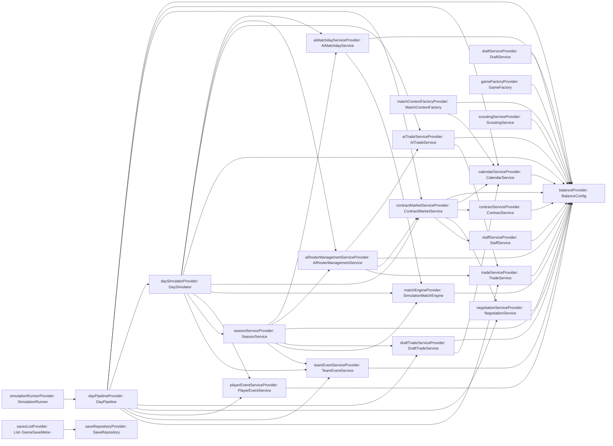
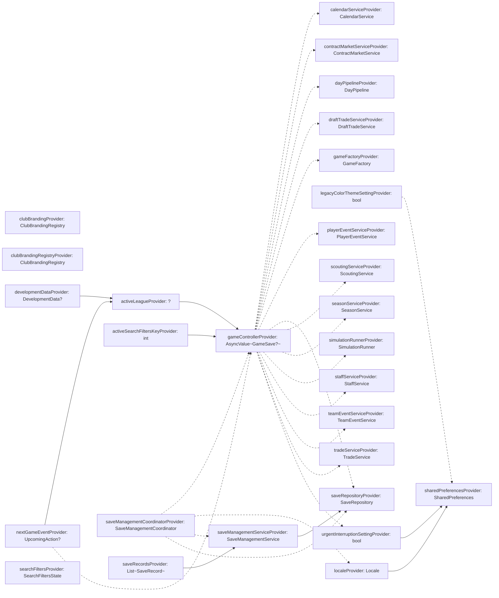

<!-- Generated by scripts/gen_class_diagrams.dart. Do not edit by hand. -->

# Aplikacja

Providery połączone przez `ref.watch` i `ref.read` oraz lista ekranów. Widżety nie są na tej stronie.

## Graf serwisów

Węzeł to `nazwa: typ` widoczny dla `ref.watch`. Ciągła krawędź to `ref.watch`, przerywana to `ref.read`. `.notifier`, `.future` i `.select(...)` liczą się jako ten sam provider. Graf serwisów jest osobno od kontrolera i ustawień.

- Ciągła krawędź: `ref.watch`.
- Przerywana krawędź: `ref.read`.
- Węzeł w stylu `nieustalone`: w ciele jest dostęp, którego provider skrypt nie rozstrzyga statycznie.

24 providery.

## Kontroler, zapis i ustawienia

Węzeł to `nazwa: typ` widoczny dla `ref.watch`. Ciągła krawędź to `ref.watch`, przerywana to `ref.read`. `.notifier`, `.future` i `.select(...)` liczą się jako ten sam provider. Graf serwisów jest osobno od kontrolera i ustawień.

- Ciągła krawędź: `ref.watch`.
- Przerywana krawędź: `ref.read`.
- Węzeł w stylu `nieustalone`: w ciele jest dostęp, którego provider skrypt nie rozstrzyga statycznie.

15 providerów.

## Ekrany i providery

Dla każdego `*_screen.dart` nazwy providerów użyte przez `ref.watch` i `ref.read`. Widżety i pliki pomocnicze obok ekranu nie wchodzą na listę.

Kolumna `watch` to `ref.watch`, kolumna `read` to `ref.read`. `nieustalone` oznacza argument, którego skrypt nie rozstrzyga statycznie.

30 ekranów.

| Ekran | watch | read | nieustalone |
| --- | --- | --- | --- |
| `calendar_screen.dart` | — | `activeLeagueProvider`, `calendarCursorMonthProvider`, `calendarServiceProvider`, `gameControllerProvider`, `shellTabIndexProvider` | — |
| `contract_screen.dart` | `activeLeagueProvider`, `balanceProvider` | `activeLeagueProvider`, `balanceProvider`, `contractMarketServiceProvider`, `contractServiceProvider`, `gameControllerProvider` | — |
| `development_screen.dart` | `activeLeagueProvider`, `balanceProvider`, `clubBrandingProvider`, `developmentDataProvider` | — | — |
| `draft_history_screen.dart` | `activeLeagueProvider` | — | — |
| `draft_screen.dart` | `activeLeagueProvider`, `balanceProvider` | `activeLeagueProvider`, `gameControllerProvider` | — |
| `finance_screen.dart` | `activeLeagueProvider`, `balanceProvider`, `clubBrandingProvider`, `legacyColorThemeSettingProvider` | — | — |
| `free_agency_screen.dart` | `activeLeagueProvider`, `balanceProvider` | `balanceProvider`, `calendarServiceProvider`, `contractMarketServiceProvider`, `contractServiceProvider`, `gameControllerProvider`, `staffServiceProvider` | — |
| `home_screen.dart` | `activeLeagueProvider`, `clubBrandingProvider`, `nextGameEventProvider` | `calendarServiceProvider` | — |
| `inbox_screen.dart` | `activeLeagueProvider` | `activeLeagueProvider`, `gameControllerProvider` | — |
| `load_game_screen.dart` | `clubBrandingProvider`, `gameFactoryProvider`, `saveRecordsProvider` | `gameControllerProvider`, `saveManagementCoordinatorProvider` | — |
| `lottery_screen.dart` | `activeLeagueProvider`, `balanceProvider` | `activeLeagueProvider`, `balanceProvider`, `draftServiceProvider`, `gameControllerProvider` | — |
| `main_menu_screen.dart` | — | — | — |
| `matchday_screen.dart` | — | `aiMatchdayServiceProvider`, `balanceProvider`, `gameControllerProvider`, `matchContextFactoryProvider`, `matchEngineProvider`, `seasonServiceProvider` | — |
| `new_game_screen.dart` | `clubBrandingProvider`, `gameFactoryProvider` | `gameControllerProvider` | — |
| `other_screen.dart` | — | — | — |
| `player_detail_screen.dart` | `activeLeagueProvider`, `balanceProvider`, `clubBrandingProvider` | — | — |
| `player_stats_screen.dart` | `activeLeagueProvider`, `clubBrandingProvider`, `legacyColorThemeSettingProvider` | `balanceProvider` | — |
| `prospects_screen.dart` | `activeLeagueProvider` | `activeLeagueProvider`, `gameControllerProvider`, `scoutingServiceProvider` | — |
| `rankings_screen.dart` | `activeLeagueProvider`, `clubBrandingProvider`, `legacyColorThemeSettingProvider` | `balanceProvider` | — |
| `rewards_screen.dart` | `activeLeagueProvider` | — | — |
| `search_filters_screen.dart` | `activeLeagueProvider`, `activeSearchFiltersKeyProvider`, `clubBrandingProvider`, `searchFiltersProvider` | `activeSearchFiltersKeyProvider`, `searchFiltersProvider` | — |
| `search_screen.dart` | `activeLeagueProvider`, `activeSearchFiltersKeyProvider`, `clubBrandingProvider`, `searchFiltersProvider` | — | — |
| `settings_screen.dart` | `legacyColorThemeSettingProvider`, `localeProvider`, `urgentInterruptionSettingProvider` | `legacyColorThemeSettingProvider`, `localeProvider`, `urgentInterruptionSettingProvider` | — |
| `shell_screen.dart` | `activeLeagueProvider`, `clubBrandingProvider`, `legacyColorThemeSettingProvider`, `shellTabIndexProvider` | `gameControllerProvider`, `shellTabIndexProvider` | — |
| `squad_screen.dart` | `activeLeagueProvider`, `balanceProvider` | `balanceProvider`, `gameControllerProvider` | — |
| `staff_screen.dart` | `activeLeagueProvider`, `balanceProvider` | `activeLeagueProvider`, `balanceProvider`, `contractMarketServiceProvider`, `gameControllerProvider`, `staffServiceProvider` | — |
| `standings_screen.dart` | `activeLeagueProvider` | `activeLeagueProvider` | — |
| `team_overview_screen.dart` | `activeLeagueProvider`, `clubBrandingProvider`, `legacyColorThemeSettingProvider` | — | — |
| `trade_history_screen.dart` | `activeLeagueProvider` | — | — |
| `trade_screen.dart` | `activeLeagueProvider` | `activeLeagueProvider`, `aiTradeServiceProvider`, `gameControllerProvider`, `tradeServiceProvider` | — |

