<!-- Generated by scripts/gen_class_diagrams.dart. Do not edit by hand. -->

# Aplikacja

Providery i serwisy, które konstruują, oraz lista ekranów. Widżety nie są na tej stronie.

## Providery i serwisy

Zmienne `*Provider` i typ, który konstruują albo deklarują w argumencie typu. Strzałka prowadzi do serwisu, repozytorium albo konfiguracji, a nie do innych providerów.

39 providerów.

```mermaid
flowchart LR
    n_activeLeagueProvider["activeLeagueProvider"]
    n_activeSearchFiltersKeyProvider["activeSearchFiltersKeyProvider"]
    n_aiMatchdayServiceProvider["aiMatchdayServiceProvider"]
    n_aiRosterManagementServiceProvider["aiRosterManagementServiceProvider"]
    n_aiTradeServiceProvider["aiTradeServiceProvider"]
    n_balanceProvider["balanceProvider"]
    n_calendarServiceProvider["calendarServiceProvider"]
    n_clubBrandingProvider["clubBrandingProvider"]
    n_clubBrandingRegistryProvider["clubBrandingRegistryProvider"]
    n_contractMarketServiceProvider["contractMarketServiceProvider"]
    n_contractServiceProvider["contractServiceProvider"]
    n_dayPipelineProvider["dayPipelineProvider"]
    n_daySimulatorProvider["daySimulatorProvider"]
    n_developmentDataProvider["developmentDataProvider"]
    n_draftServiceProvider["draftServiceProvider"]
    n_draftTradeServiceProvider["draftTradeServiceProvider"]
    n_gameControllerProvider["gameControllerProvider"]
    n_gameFactoryProvider["gameFactoryProvider"]
    n_legacyColorThemeSettingProvider["legacyColorThemeSettingProvider"]
    n_localeProvider["localeProvider"]
    n_matchContextFactoryProvider["matchContextFactoryProvider"]
    n_matchEngineProvider["matchEngineProvider"]
    n_negotiationServiceProvider["negotiationServiceProvider"]
    n_nextGameEventProvider["nextGameEventProvider"]
    n_playerEventServiceProvider["playerEventServiceProvider"]
    n_saveManagementCoordinatorProvider["saveManagementCoordinatorProvider"]
    n_saveManagementServiceProvider["saveManagementServiceProvider"]
    n_saveRecordsProvider["saveRecordsProvider"]
    n_saveRepositoryProvider["saveRepositoryProvider"]
    n_savesListProvider["savesListProvider"]
    n_scoutingServiceProvider["scoutingServiceProvider"]
    n_searchFiltersProvider["searchFiltersProvider"]
    n_seasonServiceProvider["seasonServiceProvider"]
    n_sharedPreferencesProvider["sharedPreferencesProvider"]
    n_simulationRunnerProvider["simulationRunnerProvider"]
    n_staffServiceProvider["staffServiceProvider"]
    n_teamEventServiceProvider["teamEventServiceProvider"]
    n_tradeServiceProvider["tradeServiceProvider"]
    n_urgentInterruptionSettingProvider["urgentInterruptionSettingProvider"]
    n_AiMatchdayService["AiMatchdayService"]
    n_AiRosterManagementService["AiRosterManagementService"]
    n_AiTradeService["AiTradeService"]
    n_BalanceConfig["BalanceConfig"]
    n_CalendarService["CalendarService"]
    n_ContractMarketService["ContractMarketService"]
    n_ContractService["ContractService"]
    n_DayPipeline["DayPipeline"]
    n_DaySimulator["DaySimulator"]
    n_DraftService["DraftService"]
    n_DraftTradeService["DraftTradeService"]
    n_GameFactory["GameFactory"]
    n_InlineSimulationRunner["InlineSimulationRunner"]
    n_MatchContextFactory["MatchContextFactory"]
    n_NegotiationService["NegotiationService"]
    n_PlayerEventService["PlayerEventService"]
    n_SaveManagementService["SaveManagementService"]
    n_SaveRepository["SaveRepository"]
    n_ScoutingService["ScoutingService"]
    n_SeasonService["SeasonService"]
    n_SimulationMatchEngine["SimulationMatchEngine"]
    n_SimulationRunner["SimulationRunner"]
    n_StaffService["StaffService"]
    n_TeamEventService["TeamEventService"]
    n_TradeService["TradeService"]
    n_aiMatchdayServiceProvider --> n_AiMatchdayService
    n_aiRosterManagementServiceProvider --> n_AiRosterManagementService
    n_aiTradeServiceProvider --> n_AiTradeService
    n_balanceProvider --> n_BalanceConfig
    n_calendarServiceProvider --> n_CalendarService
    n_contractMarketServiceProvider --> n_ContractMarketService
    n_contractServiceProvider --> n_ContractService
    n_dayPipelineProvider --> n_DayPipeline
    n_daySimulatorProvider --> n_DaySimulator
    n_draftServiceProvider --> n_DraftService
    n_draftTradeServiceProvider --> n_DraftTradeService
    n_gameFactoryProvider --> n_GameFactory
    n_matchContextFactoryProvider --> n_MatchContextFactory
    n_matchEngineProvider --> n_SimulationMatchEngine
    n_negotiationServiceProvider --> n_NegotiationService
    n_playerEventServiceProvider --> n_PlayerEventService
    n_saveManagementServiceProvider --> n_SaveManagementService
    n_saveRepositoryProvider --> n_SaveRepository
    n_scoutingServiceProvider --> n_ScoutingService
    n_seasonServiceProvider --> n_SeasonService
    n_simulationRunnerProvider --> n_InlineSimulationRunner
    n_simulationRunnerProvider --> n_SimulationRunner
    n_staffServiceProvider --> n_StaffService
    n_teamEventServiceProvider --> n_TeamEventService
    n_tradeServiceProvider --> n_TradeService
```

## Ekrany i providery

Pliki `*_screen.dart` i ich importy z `app/providers`. Widżety, sekcje i dialogi z tego katalogu nie wchodzą na listę.

30 ekranów.

- `calendar_screen.dart` → `game_provider.dart`
- `contract_screen.dart` → `game_provider.dart`
- `development_screen.dart` → `club_branding_provider.dart`, `development_provider.dart`, `game_provider.dart`
- `draft_history_screen.dart` → `game_provider.dart`
- `draft_screen.dart` → `game_provider.dart`
- `finance_screen.dart` → `club_branding_provider.dart`, `game_provider.dart`, `settings_provider.dart`
- `free_agency_screen.dart` → `game_provider.dart`
- `home_screen.dart` → `club_branding_provider.dart`, `game_provider.dart`
- `inbox_screen.dart` → `game_provider.dart`
- `load_game_screen.dart` → `club_branding_provider.dart`, `game_provider.dart`, `save_management_provider.dart`
- `lottery_screen.dart` → `game_provider.dart`
- `main_menu_screen.dart` → brak importu providera
- `matchday_screen.dart` → `game_provider.dart`
- `new_game_screen.dart` → `club_branding_provider.dart`, `game_provider.dart`
- `other_screen.dart` → brak importu providera
- `player_detail_screen.dart` → `club_branding_provider.dart`, `game_provider.dart`
- `player_stats_screen.dart` → `club_branding_provider.dart`, `game_provider.dart`, `settings_provider.dart`
- `prospects_screen.dart` → `game_provider.dart`
- `rankings_screen.dart` → `club_branding_provider.dart`, `game_provider.dart`, `settings_provider.dart`
- `rewards_screen.dart` → `game_provider.dart`
- `search_filters_screen.dart` → `club_branding_provider.dart`, `game_provider.dart`, `search_filters_provider.dart`
- `search_screen.dart` → `club_branding_provider.dart`, `game_provider.dart`, `search_filters_provider.dart`
- `settings_screen.dart` → `settings_provider.dart`
- `shell_screen.dart` → `club_branding_provider.dart`, `game_provider.dart`, `settings_provider.dart`
- `squad_screen.dart` → `game_provider.dart`
- `staff_screen.dart` → `game_provider.dart`
- `standings_screen.dart` → `game_provider.dart`
- `team_overview_screen.dart` → `club_branding_provider.dart`, `game_provider.dart`, `settings_provider.dart`
- `trade_history_screen.dart` → `game_provider.dart`
- `trade_screen.dart` → `game_provider.dart`

