<!-- Generated by scripts/gen_class_diagrams.dart. Do not edit by hand. -->

# Balans

Klasy konfiguracji bez pól liczbowych. Relacja pokazuje, co `BalanceConfig` trzyma.

- `lib/core/balance/message_catalog.dart`
- `lib/core/balance/message_templates_en.dart`
- `lib/core/balance/message_templates_pl.dart`
- `lib/core/balance/rivalry_catalog.dart`

## Konfiguracja balansu

`BalanceConfig` i klasy parametrów. Pola liczbowe są pominięte. Katalogi szablonów wiadomości i rywalizacji zostają poza diagramem, bo to tabele treści, a nie kształt konfiguracji.

34 typy na diagramie.

```mermaid
classDiagram
    class AiBalance {
    }
    class AwardsBalance {
    }
    class BalanceConfig {
    }
    class CalendarBalance {
    }
    class ChemistryBalance {
    }
    class ClubCashBalance {
    }
    class ContractNegBalance {
    }
    class DevelopmentBalance {
    }
    class DraftBalance {
    }
    class EventsBalance {
    }
    class FormationBaseStats {
    }
    class FormationFamily {
        <<enumeration>>
    }
    class FormationFamilyMatchup {
    }
    class FormationMatchup {
    }
    class InjuryCatalog {
    }
    class InjuryDefinition {
    }
    class MatchdayBalance {
    }
    class MessagesBalance {
    }
    class OutfieldAttrWeights {
    }
    class PlayerBalance {
    }
    class RetirementBalance {
    }
    class RosterBalance {
    }
    class RoundTradeValueRange {
    }
    class SalaryCapBalance {
    }
    class ScoutingBalance {
    }
    class SeedBalance {
    }
    class SequenceStageProfile {
    }
    class ShapeDelta {
    }
    class StaffBalance {
    }
    class TacticsBalance {
    }
    class TacticsDelta {
    }
    class TradeValueBalance {
    }
    class UiBalance {
    }
    class WeatherSeasonProfile {
    }

    BalanceConfig "1" *-- "1" AiBalance : ai
    BalanceConfig "1" *-- "1" AwardsBalance : awards
    BalanceConfig "1" *-- "1" CalendarBalance : calendar
    BalanceConfig "1" *-- "1" ChemistryBalance : chemistry
    BalanceConfig "1" *-- "1" ClubCashBalance : cash
    BalanceConfig "1" *-- "1" ContractNegBalance : contracts
    BalanceConfig "1" *-- "1" DevelopmentBalance : development
    BalanceConfig "1" *-- "1" DraftBalance : draft
    BalanceConfig "1" *-- "1" EventsBalance : events
    BalanceConfig "1" *-- "1" MatchdayBalance : matchday
    BalanceConfig "1" *-- "1" MessagesBalance : messages
    BalanceConfig "1" *-- "1" PlayerBalance : player
    BalanceConfig "1" *-- "1" RetirementBalance : retirement
    BalanceConfig "1" *-- "1" RosterBalance : roster
    BalanceConfig "1" *-- "1" SalaryCapBalance : salaryCap
    BalanceConfig "1" *-- "1" ScoutingBalance : scouting
    BalanceConfig "1" *-- "1" SeedBalance : seed
    BalanceConfig "1" *-- "1" StaffBalance : staff
    BalanceConfig "1" *-- "1" TacticsBalance : tactics
    BalanceConfig "1" *-- "1" TradeValueBalance : tradeValue
    BalanceConfig "1" *-- "1" UiBalance : ui
    FormationFamilyMatchup "1" *-- "1" FormationFamily : familyA
    FormationFamilyMatchup "1" *-- "1" FormationFamily : familyB
    MatchdayBalance "1" *-- "*" SequenceStageProfile : sequenceStages
    MatchdayBalance "1" *-- "*" WeatherSeasonProfile : weatherSeasons
    PlayerBalance "1" *-- "*" OutfieldAttrWeights : outfieldOverallWeights
    TacticsBalance "1" *-- "*" FormationBaseStats : formationBaseStats
    TacticsBalance "1" *-- "*" FormationFamily : familyShapeMatchups
    TacticsBalance "1" *-- "*" FormationFamily : formationFamily
    TacticsBalance "1" *-- "*" FormationFamilyMatchup : formationFamilyMatchups
    TacticsBalance "1" *-- "*" FormationMatchup : formationMatchups
    TacticsBalance "1" *-- "*" ShapeDelta : familyShapeMatchups
    TacticsBalance "1" *-- "*" ShapeDelta : formationShapeMatchups
    TacticsBalance "1" *-- "*" ShapeDelta : roleShapeDeltas
    TacticsBalance "1" *-- "*" ShapeDelta : roleSynergyDeltas
    TacticsBalance "1" *-- "*" ShapeDelta : settingMatchupDeltas
    TacticsBalance "1" *-- "*" TacticsDelta : attackWidthDelta
    TacticsBalance "1" *-- "*" TacticsDelta : defensiveLineDelta
    TacticsBalance "1" *-- "*" TacticsDelta : pressingDelta
    TacticsBalance "1" *-- "*" TacticsDelta : tempoDelta
    TradeValueBalance "1" *-- "*" RoundTradeValueRange : roundRanges
    ShapeDelta ..> TacticsDelta : delta
```

