<!-- Generated by scripts/gen_class_diagrams.dart. Do not edit by hand. -->

# Modele domenowe

Cztery wycinki `lib/core/models`. Każdy diagram ma własny opis i trzyma się granicy około 40 typów.

`enums.dart` jest dzielony między diagramy polem `only` w mapie `groups`, bo jeden plik miesza wszystkie domeny. Formacje i role taktyczne (`Formation`, `GkRole` i pokrewne) zostają poza tymi czterema diagramami: sama `Formation` ma ponad dwadzieścia stałych.

Poza diagramami zostają pliki bez typu w tych wycinkach albo generatory i stan UI:

- `lib/core/models/development.dart`
- `lib/core/models/development_snapshot.dart`
- `lib/core/models/draft_models.dart`
- `lib/core/models/player_value.dart`
- `lib/core/models/search_filters.dart`
- `lib/core/models/seed_clubs.dart`
- `lib/core/models/seed_data.dart`
- `lib/core/models/seed_data_generator.dart`
- `lib/core/models/seed_draft_generation.dart`
- `lib/core/models/seed_name_pools_africa.dart`
- `lib/core/models/seed_name_pools_americas.dart`
- `lib/core/models/seed_name_pools_asia.dart`
- `lib/core/models/seed_name_pools_europe.dart`
- `lib/core/models/seed_player_generation.dart`
- `lib/core/models/seed_staff_generation.dart`
- `lib/core/models/seed_team_generation.dart`

## Liga, sezon i tabela

Sezon i jego fazy, tabele konferencji, drabinka play-off, play-in, siła ligi, loteria draftu oraz koperta zapisu (`GameSave`, `SaveRecord`). `LeagueState` trzyma też drużyny, skrzynkę i negocjacje — ich klasy są na kolejnych diagramach. Z `enums.dart` są tu `Conference`, `SeasonPhase`, `PlayoffRound`, `TeamStatus` i `TeamOfSeasonSlot`.

Typów na diagramie: 32.

```mermaid
classDiagram
    class Conference {
        <<enumeration>>
        europe
        restOfTheWorld
        +String label
    }
    class ConferenceStandings {
        <<freezed>>
        +Conference conference
        +List~Standing~ standings
    }
    class ConferenceStandingsX {
        <<extension>>
        +List~Standing~ sorted
        +forTeam(String teamId) Standing?
    }
    class GameSave {
        <<freezed>>
        +LeagueState leagueState
        +GameSaveMeta meta
        +int saveSeed
        +int schemaVersion
    }
    class GameSaveMeta {
        <<freezed>>
        +DateTime createdAt
        +String id
        +String name
        +SeasonPhase phase
        +String? playerTeamName
        +int schemaVersion
        +int seasonYear
        +DateTime updatedAt
    }
    class GameSaveMetaCompatibility {
        <<extension>>
        +compatibilityWith(int supportedVersion) SaveCompatibility
    }
    class LeagueState {
        <<freezed>>
        +int currentDay
        +int? currentHour
        +int currentRound
        +Season currentSeason
        +int currentWeek
        +List~DraftedPlayerRights~ draftedRights
        +List~Player~ freeAgents
        +List~FreshUndraftedPlayer~ freshUndraftedPlayers
        +List~SeasonHistory~ history
        +bool hourlyPlayerOfferUsed
        +bool hourlyStaffOfferUsed
        +Inbox inbox
        +CompletedDraft? lastCompletedDraft
        +MessageSettings messageSettings
        +List~NegotiationBlock~ negotiationBlocks
        +List~ContractNegotiation~ negotiations
        +List~NtcTradeBlock~ ntcTradeBlocks
        +String? playerTeamId
        +List~RfaOfferSheet~ rfaOfferSheets
        +List~RfaQualifyingOffer~ rfaQualifyingOffers
        +List~StaffMember~ staffFreeAgents
        +LeagueStrengthTable? strengthTable
        +List~Team~ teams
        +List~TradeHistoryEntry~ tradeHistory
        +List~TradeOffer~ tradeOffers
    }
    class LeagueStateX {
        <<extension>>
        +List~TradeOffer~ activeTradeOffers
        +List~StaffMember~ canonicalStaffFreeAgents
        +Team? playerTeam
        +addNegotiationBlock(NegotiationBlock block) LeagueState
        +negotiationById(String id) ContractNegotiation?
        +teamById(String id) Team?
        +teamsInConference(Conference conference) List~Team~
        +tradeOfferById(String id) TradeOffer?
        +updateTeam(Team team) LeagueState
        +upsertNegotiation(ContractNegotiation negotiation) LeagueState
        +upsertTradeOffer(TradeOffer offer) LeagueState
    }
    class LeagueStrengthTable {
        <<freezed>>
        +List~TeamStrengthEntry~ entries
        +int lastCalculatedDay
        +int lastCalculatedWeek
        +int seasonYear
    }
    class LeagueStrengthTableX {
        <<extension>>
        +entryFor(String teamId) TeamStrengthEntry?
        +rankOf(String teamId, BalanceConfig balance) int
        +statusOf(String teamId) TeamStatus
    }
    class LotteryResult {
        <<freezed>>
        +int assignedPick
        +double oddsForFirstPick
        +int originalRank
        +String teamId
    }
    class LotteryTeamOdds {
        +double oddsPercent
        +int rank
        +String teamId
        +String teamName
    }
    class PlayInProgress {
        <<freezed>>
        +Conference conference
        +MatchResult? game7v8
        +MatchResult? game9v10
        +MatchResult? gameFinal
        +String seed10TeamId
        +String seed7TeamId
        +String seed8TeamId
        +String seed9TeamId
    }
    class PlayInResult {
        <<freezed>>
        +Conference conference
        +MatchResult game7v8
        +MatchResult game9v10
        +MatchResult gameFinal
        +String playoffSeed7TeamId
        +String playoffSeed8TeamId
        +String seed7TeamId
        +String seed8TeamId
    }
    class PlayoffBracket {
        <<freezed>>
        +Conference conference
        +List~PlayoffSeries~ conferenceFinal
        +PlayoffSeries? leagueFinal
        +List~PlayoffSeries~ quarterFinals
        +List~PlayoffSeries~ semiFinals
    }
    class PlayoffRound {
        <<enumeration>>
        conferenceFinal
        conferenceQuarter
        conferenceSemi
        leagueFinal
    }
    class SaveCompatibility {
        <<enumeration>>
        compatible
        newer
        older
    }
    class SaveFileInfo {
        +bool exists
        +int? sizeBytes
        +bool sizeReadFailed
    }
    class SaveManagementFailure {
        <<enumeration>>
        ambiguousWrite
        emptyName
        indexReadFailed
        invalidSerializedSave
        nameTaken
        sameName
        sourceUnavailable
        writeFailed
    }
    class SaveManagementOperation {
        <<enumeration>>
        duplicate
        rename
    }
    class SaveManagementResult {
        +bool isDuplicate
        +bool isRename
        +GameSaveMeta meta
        +SaveManagementOperation operation
    }
    class SaveRecord {
        +SaveCompatibility compatibility
        +GameSaveMeta meta
        +bool serializedFileAvailable
        +int? sizeBytes
        +bool sizeReadFailed
    }
    class SaveSchema {
        +currentVersion$
        +unknownVersion$
    }
    class Season {
        <<freezed>>
        +SeasonAwards? awards
        +bool capUpdateTvDone
        +String? championTeamId
        +bool championshipAtmosphereApplied
        +bool combineDone
        +DraftState? draftState
        +bool faOpenDone
        +bool finalMockDone
        +bool nextClassGenerationDone
        +int nextTvCapIncreasePct
        +int nextTvCapResetSeason
        +SeasonPhase phase
        +List~PlayInProgress~ playInProgress
        +List~PlayInResult~ playInResults
        +bool playerRetirementsDone
        +List~PlayoffBracket~ playoffBrackets
        +bool playoffMissAtmosphereApplied
        +List~ScheduledMatch~ postseasonFixtures
        +List~ScheduledMatch~ schedule
        +bool scoutReportDone
        +bool staffGrowthDone
        +List~ConferenceStandings~ standings
        +bool tradeDeadlineAcked
        +int year
    }
    class SeasonAwards {
        <<freezed>>
        +String? bestGkPlayerId
        +String? championTeamId
        +String? coachOfYearTeamId
        +String? dpoyPlayerId
        +String? mvpPlayerId
        +Map~String, String~ playerNames
        +String? rotyPlayerId
        +Map~TeamOfSeasonSlot, String~ teamOfSeason
        +String? topAssistPlayerId
        +String? topScorerPlayerId
        +int year
    }
    class SeasonHistory {
        <<freezed>>
        +SeasonAwards? awards
        +String? championTeamId
        +List~DraftPick~ draftPicks
        +List~ConferenceStandings~ finalStandings
        +int year
    }
    class SeasonPhase {
        <<enumeration>>
        offseason
        playIn
        playoff
        preseason
        regular
    }
    class Standing {
        <<freezed>>
        +int conferenceRank
        +int draws
        +int goalsAgainst
        +int goalsFor
        +int losses
        +String teamId
        +int wins
    }
    class StandingX {
        <<extension>>
        +int gamesPlayed
        +int goalDifference
        +int points
        +applyResult(int goalsFor, int goalsAgainst) Standing
    }
    class TeamOfSeasonSlot {
        <<enumeration>>
        cb1
        cb2
        gk
        lb
        lw
        mid1
        mid2
        mid3
        rb
        rw
        st
    }
    class TeamStatus {
        <<enumeration>>
        contender
        elite
        pretender
        rebuild
        retool
    }
    class TeamStrengthEntry {
        <<freezed>>
        +int expectedRank
        +String teamId
        +double teamPower
        +TeamStatus teamStatus
    }

    ConferenceStandings "1" *-- "1" Conference : conference
    ConferenceStandings "1" *-- "*" Standing : standings
    GameSave "1" *-- "1" GameSaveMeta : meta
    GameSave "1" *-- "1" LeagueState : leagueState
    GameSaveMeta "1" *-- "1" SeasonPhase : phase
    LeagueState "1" *-- "0..1" LeagueStrengthTable : strengthTable
    LeagueState "1" *-- "1" Season : currentSeason
    LeagueState "1" *-- "*" SeasonHistory : history
    LeagueStrengthTable "1" *-- "*" TeamStrengthEntry : entries
    PlayInProgress "1" *-- "1" Conference : conference
    PlayInResult "1" *-- "1" Conference : conference
    PlayoffBracket "1" *-- "1" Conference : conference
    SaveManagementResult "1" *-- "1" GameSaveMeta : meta
    SaveManagementResult "1" *-- "1" SaveManagementOperation : operation
    SaveRecord "1" *-- "1" GameSaveMeta : meta
    SaveRecord "1" *-- "1" SaveCompatibility : compatibility
    Season "1" *-- "*" ConferenceStandings : standings
    Season "1" *-- "*" PlayInProgress : playInProgress
    Season "1" *-- "*" PlayInResult : playInResults
    Season "1" *-- "*" PlayoffBracket : playoffBrackets
    Season "1" *-- "0..1" SeasonAwards : awards
    Season "1" *-- "1" SeasonPhase : phase
    SeasonAwards "1" *-- "*" TeamOfSeasonSlot : teamOfSeason
    SeasonHistory "1" *-- "*" ConferenceStandings : finalStandings
    SeasonHistory "1" *-- "0..1" SeasonAwards : awards
    TeamStrengthEntry "1" *-- "1" TeamStatus : teamStatus
    ConferenceStandingsX ..> ConferenceStandings : on
    GameSaveMetaCompatibility ..> GameSaveMeta : on
    LeagueStateX ..> LeagueState : on
    LeagueStrengthTableX ..> LeagueStrengthTable : on
    StandingX ..> Standing : on
```

## Zawodnik, drużyna i sztab

Zawodnik, atrybuty z pola i bramkarza, rola, kontuzja, skauting oraz drużyna ze sztabem, historią tygodnia i statystykami sezonu. Kontrakt, pick draftu i taktyka są polami `Team` i `Player`, a ich klasy są na diagramie kontraktów albo w `core/tactics`. Z `enums.dart` są tu `Position`, `StaffRole`, `InjuryType` i `InjuryGroup`.

Typów na diagramie: 40.

```mermaid
classDiagram
    class AssignedRole {
        <<freezed>>
    }
    class FieldPlayerAttributes {
        <<freezed>>
        +int defending
        +int dribbling
        +int pace
        +int passing
        +int physicality
        +int shooting
    }
    class FieldPlayerAttributesX {
        <<extension>>
        +double overall
        +overallForPosition(Position position, BalanceConfig balance) double
    }
    class GoalkeeperAttributes {
        <<freezed>>
        +int diving
        +int handling
        +int kicking
        +int positioning
        +int reflexes
        +int speed
    }
    class GoalkeeperAttributesX {
        <<extension>>
        +double averageFut
        +double overall
    }
    class Injury {
        <<freezed>>
        +int daysRemaining
        +int daysTotal
        +InjuryGroup group
        +String id
        +InjuryType type
    }
    class InjuryGroup {
        <<enumeration>>
        anklesFeet
        headFace
        knees
        legMuscles
        shouldersChest
    }
    class InjuryType {
        <<enumeration>>
        major
        minor
    }
    class InjuryX {
        <<extension>>
        +bool isActive
    }
    class Player {
        <<freezed>>
        +int age
        +PlayerAttributes attributes
        +Contract contract
        +int? draftYear
        +int heightCm
        +PlayerHidden hidden
        +String id
        +String name
        +Nationality nationality
        +AssignedRole optimalRole
        +PlayerPersonality personality
        +int pointValue
        +Position position
        +double potentialStars
        +int? previousOvr
        +double? previousPotential
        +double? seasonStartOvr
        +List~PlayerSeasonStats~ seasonStats
        +PlayerState state
    }
    class PlayerAttributes {
        <<freezed>>
    }
    class PlayerAttributesX {
        <<extension>>
        +overallForPosition(Position position, BalanceConfig balance) double
    }
    class PlayerHidden {
        <<freezed>>
        +int determination
        +double developmentCeilingStars
        +DevelopmentOutcome developmentOutcome
        +double growthRate
        +int injuryProne
        +double overallProgress
    }
    class PlayerMatchStats {
        <<freezed>>
        +int assists
        +bool cleanSheet
        +int corners
        +int duelsWon
        +int goals
        +int interceptions
        +int minutes
        +int offsides
        +int ownGoals
        +double passAccuracy
        +int passes
        +String playerId
        +double rating
        +int redCards
        +int saves
        +int shots
        +int shotsFaced
        +int shotsOnTarget
        +int staminaAfterMatch
        +int tackles
        +double xg
        +int yellowCards
    }
    class PlayerSeasonStats {
        <<freezed>>
        +int appearances
        +int assists
        +int cleanSheets
        +int corners
        +int duelsWon
        +int goals
        +int interceptions
        +int minutes
        +int motmCount
        +int offsides
        +double passAccuracy
        +int passes
        +double ratingAvg
        +int redCards
        +int saves
        +int shots
        +int shotsFaced
        +int shotsOnTarget
        +int tackles
        +double xg
        +int year
        +int yellowCards
    }
    class PlayerState {
        <<freezed>>
        +PlayerEventState eventState
        +double form
        +Injury? injury
        +int lastDevelopmentOvrDelta
        +double lastDevelopmentProgressDelta
        +int minutesThisWeek
        +int playoffYellowCards
        +int regularSeasonYellowCards
        +AssignedRole role
        +int seasonsWithTeam
        +int stamina
        +int suspensionGamesRemaining
    }
    class PlayerStateX {
        <<extension>>
        +bool injured
        +int injuryDaysRemaining
        +InjuryType? injuryType
    }
    class PlayerX {
        <<extension>>
        +PlayerSeasonStats careerSeasonStats
        +bool isAvailable
        +bool isAvailableForStartingEleven
        +bool isEligibleForStartingEleven
        +computePointValue(BalanceConfig balance) int
        +developmentCeilingOvr(BalanceConfig balance) double
        +formMult(BalanceConfig balance) double
        +overall(BalanceConfig balance) double
        +recalculatePointValue(BalanceConfig balance) Player
        +recoverBetweenMatches(BalanceConfig balance) Player
        +staminaInjuryRiskMult(BalanceConfig balance) double
        +staminaPerformanceMult(BalanceConfig balance) double
        +withMatchFatigue(int minutesPlayed, BalanceConfig balance) Player
        +withMatchForm(int minutesPlayed, double rating, bool lost, BalanceConfig balance) Player
    }
    class Position {
        <<enumeration>>
        cam
        cb
        cdm
        cm
        gk
        lb
        lw
        lwb
        rb
        rw
        rwb
        st
        +String code
    }
    class PositionAssignedRole {
        <<extension>>
        +AssignedRole defaultAssignedRole
    }
    class ScoutingKnowledge {
        <<freezed>>
        +bool determinationKnown
        +int? determinationMax
        +int? determinationMin
        +int? estimatedOvrMax
        +int? estimatedOvrMin
        +double? estimatedPotentialMax
        +double? estimatedPotentialMin
        +EstimatedDraftSlot? estimatedSlot
        +bool injuryProneKnown
        +int? injuryProneMax
        +int? injuryProneMin
        +int mockRank
        +String prospectId
        +ScoutingTier tier
        +int weeksAtCurrentTier
    }
    class StaffAttributeKey {
        <<enumeration>>
        care
        coverage
        development
        evaluation
        mentoring
        motivation
        negotiation
        prevention
        regenaration
        rehabilitation
        tactics
    }
    class StaffAttributes {
        <<freezed>>
        +double care
        +double coverage
        +double development
        +double evaluation
        +double mentoring
        +double motivation
        +double negotiation
        +double prevention
        +double regenaration
        +double rehabilitation
        +double tactics
    }
    class StaffAttributesX {
        <<extension>>
        +overallForRole(StaffRole role) double
    }
    class StaffContract {
        <<freezed>>
        +int? firstSeason
        +int? lastSeason
        +int salary
        +int yearsRemaining
    }
    class StaffMember {
        <<freezed>>
        +int age
        +StaffAttributes attributes
        +StaffContract? contract
        +String id
        +String name
        +Nationality nationality
        +StaffAttributes? previousAttributes
        +StaffRole role
    }
    class StaffMemberCollectionX {
        <<extension>>
        +canonicalStaffMembers(StaffRole? role) List~StaffMember~
    }
    class StaffMemberX {
        <<extension>>
        +double overall
        +List~StaffAttributeKey~ relevantAttributeKeys
    }
    class StaffRatingSystem {
        +double maxRating$
        +double minRating$
        +Map~StaffRole, List~StaffAttributeKey~~ roleRelevantAttributes$
        +attributeValue(StaffAttributes attributes, StaffAttributeKey key) double$
        +clampToScale(double value) double$
        +keyForSerializedName(String name) StaffAttributeKey?$
        +keysForRole(StaffRole role) List~StaffAttributeKey~$
        +rawOverall(StaffAttributes attributes, StaffRole role) double$
        +serializedNamesForRole(StaffRole role) List~String~$
    }
    class StaffRole {
        <<enumeration>>
        cfo
        doctor
        headCoach
        physio
        scout
        youthCoach
    }
    class Team {
        <<freezed>>
        +TeamAiConfig? ai
        +int atmosphere
        +List~String~ benchPlayerIds
        +double chemistry
        +Map~String, int~ chemistryAppearances
        +String city
        +Conference conference
        +TeamEventState eventState
        +TeamFinance finance
        +String id
        +List~String~ lineupPlayerIds
        +Map~String, String~ lineupSlots
        +String name
        +List~DraftPick~ ownedPicks
        +List~int~ recentMatchResults
        +List~Player~ roster
        +TeamScouting scouting
        +List~TeamSeasonStats~ seasonStats
        +TeamStaff staff
        +TacticsSetup tactics
        +List~TeamWeeklyHistory~ weeklyHistory
    }
    class TeamAiConfig {
        <<freezed>>
        +double aggressionLevel
        +Map~String, dynamic~ playerPatternMemory
        +double riskTolerance
    }
    class TeamScouting {
        <<freezed>>
        +List~String~ combineAssignedProspectIds
        +List~ScoutingKnowledge~ knowledge
        +Map~String, int~ mockRanks
        +List~String~ watchlistProspectIds
    }
    class TeamScoutingX {
        <<extension>>
        +forProspect(String prospectId) ScoutingKnowledge?
    }
    class TeamSeasonStats {
        <<freezed>>
        +int corners
        +int duelsWon
        +int fouls
        +int goals
        +int matches
        +int offsides
        +double passAccuracy
        +int passes
        +int possessionTotal
        +int redCards
        +int saves
        +int shots
        +int shotsOnTarget
        +double xg
        +int year
        +int yellowCards
    }
    class TeamSeasonStatsX {
        <<extension>>
        +int possession
        +addMatch(TeamMatchStats stats) TeamSeasonStats
    }
    class TeamStaff {
        <<freezed>>
        +StaffMember? cfo
        +StaffMember? doctor
        +StaffMember? headCoach
        +StaffMember? physio
        +StaffMember? scout
        +StaffMember? youthCoach
    }
    class TeamStaffX {
        <<extension>>
        +List~StaffMember~ members
        +int totalSalary
        +canonicalMember(StaffRole role) StaffMember?
        +member(StaffRole role) StaffMember?
        +totalSalaryFor(BalanceConfig balance) int
        +withMember(StaffRole role, StaffMember? member) TeamStaff
    }
    class TeamWeeklyHistory {
        <<freezed>>
        +int atmosphere
        +int atmosphereDelta
        +double chemistry
        +double chemistryDelta
        +int draws
        +int losses
        +int seasonYear
        +int week
        +int wins
    }
    class TeamX {
        <<extension>>
        +List~Player~ availablePlayers
        +bool isPlayerControlled
        +List~Player~ startingEleven
        +double teamStrength
        +averageTallestOutfieldHeightCm(List~Player~? onPitch, BalanceConfig balance) double
        +startingElevenFor(BalanceConfig balance) List~Player~
        +teamStrengthFor(BalanceConfig balance) double
        +updatePayroll() Team
    }

    Injury "1" *-- "1" InjuryGroup : group
    Injury "1" *-- "1" InjuryType : type
    Player "1" *-- "1" AssignedRole : optimalRole
    Player "1" *-- "1" PlayerAttributes : attributes
    Player "1" *-- "1" PlayerHidden : hidden
    Player "1" *-- "*" PlayerSeasonStats : seasonStats
    Player "1" *-- "1" PlayerState : state
    Player "1" *-- "1" Position : position
    PlayerState "1" *-- "1" AssignedRole : role
    PlayerState "1" *-- "0..1" Injury : injury
    StaffMember "1" *-- "1" StaffAttributes : attributes
    StaffMember "1" *-- "0..1" StaffAttributes : previousAttributes
    StaffMember "1" *-- "0..1" StaffContract : contract
    StaffMember "1" *-- "1" StaffRole : role
    Team "1" *-- "*" Player : roster
    Team "1" *-- "0..1" TeamAiConfig : ai
    Team "1" *-- "1" TeamScouting : scouting
    Team "1" *-- "*" TeamSeasonStats : seasonStats
    Team "1" *-- "1" TeamStaff : staff
    Team "1" *-- "*" TeamWeeklyHistory : weeklyHistory
    TeamScouting "1" *-- "*" ScoutingKnowledge : knowledge
    TeamStaff "1" *-- "0..1" StaffMember : cfo
    TeamStaff "1" *-- "0..1" StaffMember : doctor
    TeamStaff "1" *-- "0..1" StaffMember : headCoach
    TeamStaff "1" *-- "0..1" StaffMember : physio
    TeamStaff "1" *-- "0..1" StaffMember : scout
    TeamStaff "1" *-- "0..1" StaffMember : youthCoach
    FieldPlayerAttributesX ..> FieldPlayerAttributes : on
    GoalkeeperAttributesX ..> GoalkeeperAttributes : on
    InjuryX ..> Injury : on
    PlayerAttributes ..> FieldPlayerAttributes : stats
    PlayerAttributes ..> GoalkeeperAttributes : stats
    PlayerAttributesX ..> PlayerAttributes : on
    PlayerStateX ..> PlayerState : on
    PlayerX ..> Player : on
    PositionAssignedRole ..> Position : on
    StaffAttributesX ..> StaffAttributes : on
    StaffMemberCollectionX ..> StaffMember : on
    StaffMemberX ..> StaffMember : on
    TeamScoutingX ..> TeamScouting : on
    TeamSeasonStatsX ..> TeamSeasonStats : on
    TeamStaffX ..> TeamStaff : on
    TeamX ..> Team : on
```

## Kontrakty, wymiany i draft

Kontrakt zawodnika, wyjątki od capu, finanse klubu, negocjacje, prawa draftu, RFA, oferty wymiany, stan draftu i prospect. Z `enums.dart` są tu `CapExceptionType` i `EstimatedDraftSlot`.

Typów na diagramie: 34.

```mermaid
classDiagram
    class CapException {
        <<freezed>>
        +int amountRemaining
        +int? expiryYear
        +String playerId
        +CapExceptionType type
    }
    class CapExceptionType {
        <<enumeration>>
        birdRights
        earlyBirdRights
        fullBirdRights
        midLevelException
        nonBirdRights
        qualifyingOffer
        rookieExtension
        rookieScale
        tradedPlayerException
        veteranExtensionRaiseCap
    }
    class CompletedDraft {
        <<freezed>>
        +List~DraftPick~ completedPicks
        +int year
    }
    class Contract {
        <<freezed>>
        +List~String~ blockedTeamIds
        +CapExceptionType? exceptionType
        +int? firstSeason
        +bool hasBirdRights
        +bool isRookieScale
        +int? lastSeason
        +bool noTradeClause
        +int rookiePickSlot
        +int salary
        +int yearsRemaining
    }
    class ContractNegotiation {
        <<freezed>>
        +NegotiationOffer? counterOffer
        +int day
        +int expiryDay
        +int expiryHour
        +int expirySeasonYear
        +int expiryWeek
        +int hour
        +String id
        +bool isAiOffer
        +NegotiationOffer lastOffer
        +double offerScore
        +NegotiationPhase phase
        +bool requiresFinalization
        +bool rivalFinalized
        +int round
        +int seasonYear
        +bool selectedByRival
        +NegotiationStatus status
        +String subjectId
        +NegotiationSubjectKind subjectKind
        +String teamId
        +int? terminalSeasonYear
        +int? waitingUntilDay
        +int? waitingUntilHour
        +int? waitingUntilSeasonYear
        +int? waitingUntilWeek
        +int week
    }
    class ContractNegotiationX {
        <<extension>>
        +bool isTerminal
    }
    class DraftClass {
        <<freezed>>
        +List~Prospect~ prospects
        +int year
    }
    class DraftPick {
        <<freezed>>
        +String id
        +String originalTeamId
        +int? pickNumber
        +String? playerName
        +String? prospectId
        +int? protectedTopN
        +int round
        +String teamId
        +int tradeValue
        +int year
    }
    class DraftPickX {
        <<extension>>
        +computeTradeValue(int currentYear, int? expectedRank, BalanceConfig balance) int
        +recalculateTradeValue(int currentYear, int? expectedRank, BalanceConfig balance) DraftPick
    }
    class DraftState {
        <<freezed>>
        +List~DraftPick~ completedPicks
        +int currentPickIndex
        +DraftClass draftClass
        +List~LotteryResult~ lotteryResults
        +MockDraftBoard? mockDraftBoard
        +List~DraftPick~ order
        +int year
    }
    class DraftedPlayerRights {
        <<freezed>>
        +int draftYear
        +String id
        +String ownerTeamId
        +int pickNumber
        +Player player
        +bool reminderSent
    }
    class EstimatedDraftSlot {
        <<enumeration>>
        r1
        r2
        r3
        top1
        top10
        top3
        top5
        x
    }
    class FreshUndraftedPlayer {
        <<freezed>>
        +int activeFromSeasonYear
        +int activeFromWeek
        +int activeUntilSeasonYear
        +int activeUntilWeek
        +int draftYear
        +String playerId
    }
    class FreshUndraftedPlayerX {
        <<extension>>
        +isActiveAt(int seasonYear, int week) bool
    }
    class MockDraftBoard {
        <<freezed>>
        +Map~String, int~ displayedRank
        +Map~String, int~ previousDisplayedRank
    }
    class NegotiationBlock {
        <<freezed>>
        +String subjectId
        +NegotiationSubjectKind subjectKind
        +String teamId
        +int untilDay
        +int untilHour
        +int untilSeasonYear
        +int untilWeek
    }
    class NegotiationOffer {
        <<freezed>>
        +CapExceptionType? exception
        +int? rookiePickSlot
        +int salary
        +int years
    }
    class NegotiationPhase {
        <<enumeration>>
        contractExtension
        freeAgencyPhaseI
        freeAgencyPhaseII
    }
    class NegotiationStatus {
        <<enumeration>>
        active
        cancelled
        completed
        counter
        hardRejected
        pendingFinalization
        rejected
        waiting
    }
    class NegotiationSubjectKind {
        <<enumeration>>
        player
        staff
    }
    class NtcTradeBlock {
        <<freezed>>
        +DateTime createdAt
        +String destinationTeamId
        +DateTime expiresAt
        +String playerId
    }
    class NtcTradeBlockX {
        <<extension>>
        +isActiveAt(DateTime now) bool
    }
    class Prospect {
        <<freezed>>
        +int age
        +PlayerAttributes attributes
        +int combineScore
        +int determination
        +int heightCm
        +String id
        +int injuryProne
        +String name
        +Nationality nationality
        +AssignedRole optimalRole
        +PlayerPersonality personality
        +Position position
        +double potentialStars
        +int scoutGrade
    }
    class ProspectX {
        <<extension>>
        +projectedOverall(BalanceConfig balance) double
        +toPlayer(Contract contract, Random rng, int? draftYear, BalanceConfig balance) Player
    }
    class RfaOfferSheet {
        <<freezed>>
        +int day
        +bool declined
        +int expiryDay
        +int expiryHour
        +int expirySeasonYear
        +int expiryWeek
        +int hour
        +String id
        +bool matched
        +String offeringTeamId
        +String originalTeamId
        +NegotiationPhase phase
        +String playerId
        +int salary
        +int seasonYear
        +int week
        +int years
    }
    class RfaOfferSheetX {
        <<extension>>
        +bool isTerminal
    }
    class RfaQualifyingOffer {
        <<freezed>>
        +bool declined
        +String ownerTeamId
        +String playerId
        +int salary
        +int seasonYear
        +int years
    }
    class TeamFinance {
        <<freezed>>
        +List~CapException~ activeExceptions
        +int cashBalance
        +int firstApron
        +int midLevelExceptionAmount
        +bool midLevelExceptionAvailable
        +int salaryCap
        +int secondApron
        +int totalPayroll
    }
    class TeamFinanceX {
        <<extension>>
        +int capSpace
        +canSignPlayer(int salary, CapExceptionType? exception) bool
    }
    class TradeAssetSnapshot {
        <<freezed>>
        +String? draftedRightsId
        +String? originalTeamId
        +String? pickId
        +int? pickRound
        +int? pickYear
        +String? playerId
        +String type
    }
    class TradeHistoryEntry {
        <<freezed>>
        +List~TradeAssetSnapshot~ assetsFromA
        +List~TradeAssetSnapshot~ assetsFromB
        +int day
        +String id
        +double? ntcConsentProbability
        +String? ntcPlayerId
        +String? offerId
        +String outcome
        +String? reason
        +int round
        +int seasonYear
        +String teamAId
        +String teamBId
        +String? threadId
        +int week
    }
    class TradeOffer {
        <<freezed>>
        +List~TradeAssetSnapshot~ assetsFromA
        +List~TradeAssetSnapshot~ assetsFromB
        +String awaitingTeamId
        +int day
        +int expiryDay
        +int expiryHour
        +int expirySeasonYear
        +int expiryWeek
        +int hour
        +String id
        +String? parentOfferId
        +String? reason
        +int round
        +int seasonYear
        +TradeOfferStatus status
        +String? supersededById
        +String teamAId
        +String teamBId
        +String threadId
        +int week
    }
    class TradeOfferStatus {
        <<enumeration>>
        accepted
        cancelled
        countered
        expired
        hardRejected
        ntcRefused
        pending
        rejected
    }
    class TradeOfferX {
        <<extension>>
        +bool isPending
        +bool isTerminal
    }

    CapException "1" *-- "1" CapExceptionType : type
    CompletedDraft "1" *-- "*" DraftPick : completedPicks
    Contract "1" *-- "0..1" CapExceptionType : exceptionType
    ContractNegotiation "1" *-- "0..1" NegotiationOffer : counterOffer
    ContractNegotiation "1" *-- "1" NegotiationOffer : lastOffer
    ContractNegotiation "1" *-- "1" NegotiationPhase : phase
    ContractNegotiation "1" *-- "1" NegotiationStatus : status
    ContractNegotiation "1" *-- "1" NegotiationSubjectKind : subjectKind
    DraftClass "1" *-- "*" Prospect : prospects
    DraftState "1" *-- "1" DraftClass : draftClass
    DraftState "1" *-- "*" DraftPick : completedPicks
    DraftState "1" *-- "*" DraftPick : order
    DraftState "1" *-- "0..1" MockDraftBoard : mockDraftBoard
    NegotiationBlock "1" *-- "1" NegotiationSubjectKind : subjectKind
    NegotiationOffer "1" *-- "0..1" CapExceptionType : exception
    RfaOfferSheet "1" *-- "1" NegotiationPhase : phase
    TeamFinance "1" *-- "*" CapException : activeExceptions
    TradeHistoryEntry "1" *-- "*" TradeAssetSnapshot : assetsFromA
    TradeHistoryEntry "1" *-- "*" TradeAssetSnapshot : assetsFromB
    TradeOffer "1" *-- "*" TradeAssetSnapshot : assetsFromA
    TradeOffer "1" *-- "*" TradeAssetSnapshot : assetsFromB
    TradeOffer "1" *-- "1" TradeOfferStatus : status
    ContractNegotiationX ..> ContractNegotiation : on
    DraftPickX ..> DraftPick : on
    FreshUndraftedPlayerX ..> FreshUndraftedPlayer : on
    NtcTradeBlockX ..> NtcTradeBlock : on
    ProspectX ..> Prospect : on
    RfaOfferSheetX ..> RfaOfferSheet : on
    TeamFinanceX ..> TeamFinance : on
    TradeOfferX ..> TradeOffer : on
```

## Mecz, wiadomości i zdarzenia

Zdarzenia i statystyki meczu, konfiguracja spotkania, stan symulacji, skrzynka wiadomości oraz modyfikatory zawodnika i drużyny. Z `enums.dart` są tu `MatchEventType`, `MatchStatus`, `MatchStake`, `MessageType`, `MessageDomain` i `MessagePriority`.

Typów na diagramie: 39.

```mermaid
classDiagram
    class DecisionSpec {
        <<freezed>>
        +String defaultOnExpiry
        +List~MessageAction~ options
    }
    class GameMessage {
        <<freezed>>
        +bool acknowledged
        +List~MessageAction~ actions
        +Map~String, dynamic~ args
        +String bodyKey
        +int day
        +DecisionSpec? decision
        +String? dedupKey
        +MessageDomain domain
        +String? expiresAt
        +String? groupKey
        +String id
        +String? kind
        +Map~String, dynamic~ payload
        +MessagePriority priority
        +bool read
        +int seasonYear
        +String titleKey
        +MessageType type
        +int week
    }
    class GameMessagePayloadX {
        <<extension>>
        +degradeMissingPayload(Set~String~? playerIds, Set~String~? teamIds, Set~String~? tradeOfferIds, Set~String~? negoti...) GameMessage
    }
    class Inbox {
        <<freezed>>
        +List~GameMessage~ archive
        +List~GameMessage~ messages
        +List~GameMessage~ scheduled
    }
    class InboxX {
        <<extension>>
        +List~GameMessage~ pendingUrgent
        +List~GameMessage~ unread
        +acknowledge(String id) Inbox
        +addMessage(GameMessage message, MessagesBalance balance, int? digestMinItems, int? maxUnread) Inbox
        +degradeMissingPayload(Set~String~? playerIds, Set~String~? teamIds, Set~String~? tradeOfferIds, Set~String~? negoti...) Inbox
        +deliverScheduled(int week, int day, int? hour, MessagesBalance balance) Inbox
        +markRead(String id) Inbox
        +retainSeasons(int currentSeasonYear, MessagesBalance balance, int? retentionSeasons) Inbox
        +scheduleMessage(GameMessage message, MessagesBalance balance) Inbox
    }
    class MatchContext {
        <<freezed>>
        +int awayMatchInWeek
        +String awayTeamId
        +int crowdIntensity
        +double homeAdvantage
        +int homeMatchInWeek
        +String homeTeamId
        +bool isDerby
        +double refereeStrictness
        +int seed
        +MatchStake stake
        +int temperatureC
        +Weather weather
    }
    class MatchDiscipline {
        <<freezed>>
        +int directRedSeverity
        +String playerId
        +bool playerInStartingXi
        +RedCardKind redCardKind
        +String teamId
        +int yellowCardsInMatch
    }
    class MatchEvent {
        <<freezed>>
        +String? description
        +int minute
        +String? playerId
        +String teamId
        +MatchEventType type
    }
    class MatchEventType {
        <<enumeration>>
        foul
        fullTime
        goal
        halfTime
        majorInjury
        minorInjury
        missedPenalty
        redCard
        scoredPenalty
        substitution
        yellowCard
    }
    class MatchInjury {
        <<freezed>>
        +Injury injury
        +String playerId
        +bool playerInStartingXi
        +bool potentialLoss
        +String teamId
    }
    class MatchResult {
        <<freezed>>
        +int awayGoals
        +List~Player~ awayLineup
        +List~Position~ awayLineupPositions
        +MatchTeamSnapshot awaySnapshot
        +TeamMatchStats awayStats
        +TacticsSetup awayTactics
        +String awayTeamId
        +MatchContext context
        +List~MatchDiscipline~ disciplines
        +List~MatchEvent~ events
        +int homeGoals
        +List~Player~ homeLineup
        +List~Position~ homeLineupPositions
        +MatchTeamSnapshot homeSnapshot
        +TeamMatchStats homeStats
        +TacticsSetup homeTactics
        +String homeTeamId
        +List~MatchInjury~ injuries
        +String? inspiredPerformancePlayerId
        +bool isWalkover
        +String? manOfTheMatchPlayerId
        +int matchEndMinute
        +bool noGkPenalty
        +List~String~ noGkPenaltyTeamIds
        +List~PlayerMatchStats~ playerStats
        +String? reasonCode
        +int shootoutAwayGoals
        +int shootoutHomeGoals
        +MatchStatus status
        +int stoppageTime
        +List~String~ violatingTeamIds
        +bool wentToExtraTime
        +bool wentToShootout
        +String? winnerTeamId
    }
    class MatchResultX {
        <<extension>>
        +slimForStorage() MatchResult
    }
    class MatchSetup {
        <<freezed>>
        +List~Player~ awayLineup
        +TacticsSetup awayTactics
        +String awayTeamId
        +List~Player~ homeLineup
        +TacticsSetup homeTactics
        +String homeTeamId
        +bool isHomeAdvantage
        +int roundNumber
    }
    class MatchStake {
        <<enumeration>>
        leagueFinal
        playIn
        playoff
        playoffElimination
        regular
    }
    class MatchState {
        <<freezed>>
        +List~Player~ awayBench
        +int awayGoals
        +List~Player~ awayLineup
        +TacticsSetup awayTactics
        +MatchContext context
        +List~Player~ homeBench
        +int homeGoals
        +List~Player~ homeLineup
        +TacticsSetup homeTactics
        +List~String~ injuriesThisMatch
        +int minute
        +double momentum
        +double moraleModAway
        +double moraleModHome
        +int? rngSeed
        +List~String~ sentOffPlayerIds
        +Map~String, int~ yellowCardCounts
    }
    class MatchStatus {
        <<enumeration>>
        dsq
        played
        walkover
    }
    class MatchTeamSnapshot {
        <<freezed>>
        +List~Position~ assignedPositions
        +List~AssignedRole~ assignedRoles
        +int atmosphere
        +List~Player~ bench
        +double chemistry
        +double cohesionMultiplier
        +TeamStaff staff
        +List~Player~ startingXi
        +TacticsSetup tactics
        +String teamId
    }
    class MessageAction {
        <<freezed>>
        +String id
        +String labelKey
    }
    class MessageDomain {
        <<enumeration>>
        contracts
        draft
        finance
        health
        matchday
        playerEvent
        roster
        season
        staff
        system
        teamEvent
        trades
    }
    class MessagePriority {
        <<enumeration>>
        normal
        silenced
        urgent
    }
    class MessageSettings {
        <<freezed>>
        +Map~MessageDomain, NotificationLevel~ domainOverrides
        +Map~MessageType, NotificationLevel~ overrides
    }
    class MessageSettingsX {
        <<extension>>
        +levelFor(MessageType type, MessageDomain? domain) NotificationLevel
        +withDomainLevel(MessageDomain domain, NotificationLevel level) MessageSettings
        +withTypeLevel(MessageType type, NotificationLevel level) MessageSettings
    }
    class MessageType {
        <<enumeration>>
        apronWarning
        atmosphere
        award
        benchIncomplete
        calendar
        capUpdateTv
        combine
        contractExpired
        contractExpiring
        contractLostToRival
        contractOffer
        contractOfferResponse
        contractSigned
        declineToExtend
        draftPick
        draftPickLeague
        draftedRightsReminder
        injury
        injuryRecurrence
        injuryReturn
        lineupNoGk
        lottery
        mockDraft
        ovrDigest
        playInResult
        playerEvent
        playoffMissed
        playoffSeeding
        potentialLoss
        retirementLeagueDigest
        retirementPlayer
        retirementStaff
        rfaOfferSheet
        rosterWarning
        scoutReport
        seasonSummary
        staffCapViolation
        staffFired
        staffGrowth
        staffHired
        staffOfferResponse
        staffSigned
        staffSlotEmpty
        suspensionEnd
        suspensionStart
        system
        teamEvent
        teamStatusChange
        trade
        tradeOffer
        tradeWindowEvent
        walkover
    }
    class MinutesHistoryEntry {
        <<freezed>>
        +int minutes
        +String playerId
        +int possibleMinutes
        +int seasonYear
        +int week
    }
    class PlayerEventState {
        <<freezed>>
        +Map~String, int~ cooldowns
        +Map~String, int~ counters
        +Injury? lastMajorInjury
        +bool lateBloomerTriggered
        +bool majorInjuryActiveLastTick
        +List~TimedModifier~ modifiers
        +bool personalProblemsFollowUpPending
        +int weeksSinceMajorInjury
    }
    class PlayerEventStateX {
        <<extension>>
        +addModifier(String type, double value, int weeks) PlayerEventState
        +advanceWeek() PlayerEventState
        +clearModifier(String type) PlayerEventState
        +counterValue(String counter) int
        +expireModifiers() PlayerEventState
        +hasModifier(String type) bool
        +isOnCooldown(String event) bool
        +modifierOf(String type) TimedModifier?
        +modifierValue(String type) double
        +replaceModifier(String type, double value, int weeks) PlayerEventState
        +shortenModifiers(String type, int maxWeeks) PlayerEventState
        +withCooldown(String event, int weeks) PlayerEventState
        +withCounter(String counter, int value) PlayerEventState
    }
    class PlayoffSeries {
        <<freezed>>
        +List~MatchResult~ games
        +String higherSeedTeamId
        +int higherSeedWins
        +String id
        +String? lowerSeedPlaceholderLabel
        +String lowerSeedTeamId
        +int lowerSeedWins
        +String? winnerTeamId
        +int winsNeeded
    }
    class PlayoffSeriesX {
        <<extension>>
        +bool isComplete
        +bool isPending
        +recordGame(MatchResult result) PlayoffSeries
    }
    class ScheduledMatch {
        <<freezed>>
        +String? awayPlaceholderLabel
        +String awayTeamId
        +bool confirmed
        +int? day
        +String? homePlaceholderLabel
        +String homeTeamId
        +String id
        +MatchResult? result
        +int round
        +int? week
    }
    class SeasonMinutesAggregate {
        <<freezed>>
        +int actualMinutes
        +String playerId
        +int possibleMinutes
        +int seasonYear
    }
    class TeamEventState {
        <<freezed>>
        +Map~String, int~ cooldowns
        +int lowAtmosphereWeeks
        +List~MinutesHistoryEntry~ minutesHistory
        +List~TeamTimedModifier~ modifiers
        +Map~String, double~ pointValueMultipliers
        +List~TeamPromise~ promises
        +double publicCriticismRollMultiplier
        +Map~String, int~ seasonFlags
        +List~SeasonMinutesAggregate~ seasonMinutes
        +List~TeamTransferSituation~ transferSituations
    }
    class TeamEventStateX {
        <<extension>>
        +double negativeEventMultiplier
        +addModifier(String type, double value, int weeks) TeamEventState
        +advanceWeek() TeamEventState
        +clearModifier(String type) TeamEventState
        +clearPlayer(String playerId) TeamEventState
        +clearPlayers(Set~String~ playerIds) TeamEventState
        +clearPointValueMultiplier(String playerId) TeamEventState
        +hasModifier(String type) bool
        +hasSeasonFlag(String key, int seasonYear) bool
        +isOnCooldown(String event) bool
        +modifierOf(String type) TeamTimedModifier?
        +modifierValue(String type) double
        +negativeEventMultiplierFor(BalanceConfig balance) double
        +pointValueMultiplierFor(String playerId) double
        +promiseFor(String playerId, String? kind) TeamPromise?
        +recordMinutes(Iterable~MinutesHistoryEntry~ entries, int currentSeasonYear, int currentWeek, BalanceConfig ...) TeamEventState
        +replaceModifier(String type, double value, int weeks) TeamEventState
        +resetForSeason() TeamEventState
        +seasonMinutesFor(String playerId) SeasonMinutesAggregate?
        +transferSituationFor(String playerId) TeamTransferSituation?
        +withCooldown(String event, int weeks) TeamEventState
        +withPointValueMultiplier(String playerId, double multiplier, BalanceConfig balance) TeamEventState
        +withSeasonFlag(String key, int seasonYear) TeamEventState
    }
    class TeamMatchStats {
        <<freezed>>
        +int corners
        +int duelsWon
        +int fouls
        +int goals
        +int offsides
        +double passAccuracy
        +int passes
        +int possession
        +int redCards
        +int saves
        +int shots
        +int shotsOnTarget
        +String teamId
        +double xg
        +int yellowCards
    }
    class TeamPromise {
        <<freezed>>
        +int createdSeasonYear
        +int createdWeek
        +int durationWeeks
        +String id
        +String kind
        +String playerId
        +double requiredMinutesShare
        +int weeksElapsed
    }
    class TeamTimedModifier {
        <<freezed>>
        +String type
        +double value
        +int weeksRemaining
    }
    class TeamTimedModifierX {
        <<extension>>
        +bool isActive
        +decrementWeek() TeamTimedModifier?
    }
    class TeamTransferSituation {
        <<freezed>>
        +int createdSeasonYear
        +int createdWeek
        +String id
        +String kind
        +String playerId
        +int weeksRemaining
    }
    class TimedModifier {
        <<freezed>>
        +String type
        +double value
        +int weeksRemaining
    }
    class TimedModifierX {
        <<extension>>
        +bool isActive
        +decrementWeek() TimedModifier?
    }

    DecisionSpec "1" *-- "*" MessageAction : options
    GameMessage "1" *-- "0..1" DecisionSpec : decision
    GameMessage "1" *-- "*" MessageAction : actions
    GameMessage "1" *-- "1" MessageDomain : domain
    GameMessage "1" *-- "1" MessagePriority : priority
    GameMessage "1" *-- "1" MessageType : type
    Inbox "1" *-- "*" GameMessage : archive
    Inbox "1" *-- "*" GameMessage : messages
    Inbox "1" *-- "*" GameMessage : scheduled
    MatchContext "1" *-- "1" MatchStake : stake
    MatchEvent "1" *-- "1" MatchEventType : type
    MatchResult "1" *-- "1" MatchContext : context
    MatchResult "1" *-- "*" MatchDiscipline : disciplines
    MatchResult "1" *-- "*" MatchEvent : events
    MatchResult "1" *-- "*" MatchInjury : injuries
    MatchResult "1" *-- "1" MatchStatus : status
    MatchResult "1" *-- "1" MatchTeamSnapshot : awaySnapshot
    MatchResult "1" *-- "1" MatchTeamSnapshot : homeSnapshot
    MatchResult "1" *-- "1" TeamMatchStats : awayStats
    MatchResult "1" *-- "1" TeamMatchStats : homeStats
    MatchState "1" *-- "1" MatchContext : context
    MessageSettings "1" *-- "*" MessageDomain : domainOverrides
    MessageSettings "1" *-- "*" MessageType : overrides
    PlayerEventState "1" *-- "*" TimedModifier : modifiers
    PlayoffSeries "1" *-- "*" MatchResult : games
    ScheduledMatch "1" *-- "0..1" MatchResult : result
    TeamEventState "1" *-- "*" MinutesHistoryEntry : minutesHistory
    TeamEventState "1" *-- "*" SeasonMinutesAggregate : seasonMinutes
    TeamEventState "1" *-- "*" TeamPromise : promises
    TeamEventState "1" *-- "*" TeamTimedModifier : modifiers
    TeamEventState "1" *-- "*" TeamTransferSituation : transferSituations
    GameMessagePayloadX ..> GameMessage : on
    InboxX ..> Inbox : on
    MatchResultX ..> MatchResult : on
    MessageSettingsX ..> MessageSettings : on
    PlayerEventStateX ..> PlayerEventState : on
    PlayoffSeriesX ..> PlayoffSeries : on
    TeamEventStateX ..> TeamEventState : on
    TeamTimedModifierX ..> TeamTimedModifier : on
    TimedModifierX ..> TimedModifier : on
```

