<!-- Generated by scripts/gen_class_diagrams.dart. Do not edit by hand. -->

# Trwałość

`lib/data` oraz `lib/core/random`. Interfejs repozytorium zostaje w `core/services`, a adapter w `data` go implementuje.

Każdy ręczny plik z `lib/data` jest na diagramie.

## Zapis i losowość

Repozytorium zapisu, jego transakcja i odczyt, adapter interfejsu z `core/services` oraz generatory liczb z `core/random`.

27 typów na diagramie.

```mermaid
classDiagram
    class DecisionType {
        <<enumeration>>
        draftPick
        eventResolve
        extension
        faOffer
        formation
        lineup
        rosterFix
        scoutAssign
        subs
        tactics
        tradeEval
        tradeInit
    }
    class InvalidSerializedSaveException {
        +String saveId
    }
    class MatchRandom {
        +int cursor
        +bool recordRolls
        +List~MatchRandomRoll~ rolls
        +int seed
        +nextBool() bool
        +nextDouble() double
        +nextGaussian() double
        +nextInt(int max) int
        +nextPoisson(double lambda) int
        +pickWeighted(Map~T, double~ weights) T
    }
    class MatchRandomRoll {
        +String kind
        +double value
    }
    class SaveAmbiguousWriteException {
        +String saveId
    }
    class SaveFileNotFoundException {
        +String saveId
    }
    class SaveManagementException {
        +Object? cause
        +SaveManagementFailure code
        +SaveManagementFailure failure
    }
    class SaveManagementRepository {
        +duplicateRaw(String sourceId, GameSaveMeta duplicateMeta) Future~GameSaveMeta~
        +inspectFile(String id) Future~SaveFileInfo~
        +isSaveIdAvailable(String id) Future~bool~
        +listSaves() Future~List~GameSaveMeta~~
        +renameRaw(String id, String newName) Future~GameSaveMeta~
    }
    class SaveManagementRepositoryAdapter {
        +duplicateRaw(String sourceId, GameSaveMeta duplicateMeta) Future~GameSaveMeta~
        +inspectFile(String id) Future~SaveFileInfo~
        +isSaveIdAvailable(String id) Future~bool~
        +listSaves() Future~List~GameSaveMeta~~
        +renameRaw(String id, String newName) Future~GameSaveMeta~
    }
    class SaveRepository {
        +currentSchemaVersion$
        +List~StaffDataDiagnostic~ lastStaffDiagnostics
        +bool saveInIsolate
        +bool verifyTypedCommit
        +delete(String id) Future~void~
        +initializeCoordinator() void$
        +inspectFile(String id) Future~SaveFileInfo~
        +isSaveIdAvailable(String id) Future~bool~
        +listSaves() Future~List~GameSaveMeta~~
        +load(String id) Future~GameSave~
        +save(GameSave gameSave) Future~void~
    }
    class SaveRepositoryCheckpoint {
        <<enumeration>>
        committed
        gameDisplaced
        gamePublished
        indexDisplaced
        indexPublished
        prepared
    }
    class SaveRepositoryException {
        +Object? cause
        +String message
    }
    class SaveRepositoryWriteStage {
        <<enumeration>>
        gameFile
        indexFile
    }
    class SaveSchemaMismatchException {
        +int foundVersion
        +bool isNewer
        +bool isOlder
        +int supportedVersion
    }
    class StaffCompatibilityResult~T~ {
        +T data
        +List~StaffDataDiagnostic~ diagnostics
        +bool hasDiagnostics
        +bool isCompatible
        +T json
        +T normalizedJson
        +T sanitizedJson
        +T value
    }
    class StaffDataCompatibility {
        +List~String~ canonicalRoleNames$
        +List~String~ teamStaffSlotNames$
        +isRecognizedRole(Object? rawRole) bool$
        +normalize(Map~String, dynamic~ json) StaffCompatibilityResult~Map~String, dynamic~~$
        +normalizeGameSaveJson(Map~String, dynamic~ json) StaffCompatibilityResult~Map~String, dynamic~~$
        +normalizeLeagueStateJson(Map~String, dynamic~ json) StaffCompatibilityResult~Map~String, dynamic~~$
        +roleForSerializedName(Object? rawRole) StaffRole?$
        +sanitize(Map~String, dynamic~ json) StaffCompatibilityResult~Map~String, dynamic~~$
        +sanitizeGameSave(Map~String, dynamic~ json) StaffCompatibilityResult~Map~String, dynamic~~$
        +sanitizeGameSaveJson(Map~String, dynamic~ json) StaffCompatibilityResult~Map~String, dynamic~~$
        +sanitizeLeagueState(Map~String, dynamic~ json) StaffCompatibilityResult~Map~String, dynamic~~$
        +sanitizeLeagueStateJson(Map~String, dynamic~ json) StaffCompatibilityResult~Map~String, dynamic~~$
    }
    class StaffDataDiagnostic {
        +String code
        +String? details
        +String? id
        +String? memberId
        +String message
        +String path
        +Object? rawRole
        +String reason
    }
    class StaffDataDiagnosticReason {
        +duplicateStaffRecord$
        +malformedFreeAgentList$
        +malformedLeagueState$
        +malformedStaffMap$
        +malformedStaffRecord$
        +roleSlotMismatch$
        +unknownRole$
    }
    class _CommittedSaveJson {
        +Map~String, dynamic~ gameJson
        +List~dynamic~ indexJson
    }
    class _PreparedSaveFile {
        +File backup
        +File destination
        +File displaced
        +_SaveFingerprint? original
        +File restoring
        +SaveRepositoryWriteStage stage
        +File temporary
    }
    class _PreparedSaveTransaction {
        +File commitMarker
        +List~_PreparedSaveFile~ files
        +_PreparedSaveFile gameFile
        +String id
        +_PreparedSaveFile indexFile
        +File journal
        +String saveId
    }
    class _SaveDirectoryCoordinator {
        +run(Directory directory, Function action) Future~T~$
    }
    class _SaveFingerprint {
        +int bytes
        +String hash
        +matches(File file) Future~bool~
        +read(File file) Future~_SaveFingerprint?~$
    }
    class _SaveRecovery {
        +journalName$
        +begin(_PreparedSaveTransaction transaction) Future~void~$
        +cleanup(_PreparedSaveTransaction transaction) Future~void~$
        +commit(_PreparedSaveTransaction transaction) Future~void~$
        +recover(Directory directory) Future~void~$
        +validateId(String id) void$
    }
    class _SaveRepositoryRawOperations {
        <<mixin>>
        +duplicateRaw(String sourceId, GameSaveMeta duplicateMeta) Future~GameSaveMeta~
        +readRawSave(String sourceId) Future~Map~String, dynamic~~
        +renameRaw(String id, String newName) Future~GameSaveMeta~
    }
    class _SaveRepositoryShared {
        <<mixin>>
        +bool verifyTypedCommit
    }
    class _SaveRepositoryTransaction {
        <<mixin>>
    }

    SaveRepositoryException <|-- InvalidSerializedSaveException
    SaveRepositoryException <|-- SaveAmbiguousWriteException
    SaveRepositoryException <|-- SaveFileNotFoundException
    SaveRepositoryException <|-- SaveSchemaMismatchException
    SaveManagementRepository <|.. SaveManagementRepositoryAdapter : implements
    _SaveRepositoryRawOperations <|.. SaveRepository : with
    _SaveRepositoryShared <|.. SaveRepository : with
    _SaveRepositoryTransaction <|.. SaveRepository : with
    _SaveRepositoryShared <|.. _SaveRepositoryRawOperations : on
    _SaveRepositoryShared <|.. _SaveRepositoryTransaction : on
    StaffCompatibilityResult~T~ "1" *-- "*" StaffDataDiagnostic : diagnostics
    _PreparedSaveFile "1" *-- "1" SaveRepositoryWriteStage : stage
    _PreparedSaveFile "1" *-- "0..1" _SaveFingerprint : original
    _PreparedSaveTransaction "1" *-- "1" _PreparedSaveFile : gameFile
    _PreparedSaveTransaction "1" *-- "1" _PreparedSaveFile : indexFile
```

