<!-- Generated by scripts/gen_class_diagrams.dart. Do not edit by hand. -->

# Serwisy

Pięć wycinków `lib/core/services`. Mixiny prywatne są na diagramie, bo to one dzielą sezon, dzień, rynek i zdarzenia.

- `lib/core/services/cohesion_service.dart`
- `lib/core/services/game_factory.dart`
- `lib/core/services/league_strength_service.dart`
- `lib/core/services/match_post_match_service.dart`
- `lib/core/services/save_management_service.dart`
- `lib/core/services/save_name_policy.dart`
- `lib/core/services/scouting_service.dart`
- `lib/core/services/search_filter_matching.dart`
- `lib/core/services/team_management_service.dart`

## Sezon i kalendarz

Rejestr zdarzeń kalendarza, generator terminarza oraz `SeasonService` z mixinami faz sezonu, draftu, play-in, play-off i loterii.

24 typy na diagramie.

```mermaid
classDiagram
    class CalendarEventExecution {
        <<enumeration>>
        automatic
        playerAction
    }
    class CalendarEventId {
        <<enumeration>>
        awards
        capUpdateTv
        combine
        contractExtensions
        draft
        finalMock
        freeAgencyOpen
        lottery
        nextClassGeneration
        retirements
        scoutReport
        staffGrowth
        tradeDeadline
        tradeWindowOpen
    }
    class CalendarEventKind {
        <<enumeration>>
        automatic
        informational
        match
        playerAction
    }
    class CalendarEventRegistry {
        +build(CalendarBalance calendar) List~CalendarEventSlot~$
        +buildWindows(CalendarBalance calendar) List~CalendarEventWindow~$
        +isDone(Season season, CalendarEventId id) bool$
        +nextEvent(LeagueState league, BalanceConfig balance) CalendarEventSlot?$
        +unresolvedEventsOn(LeagueState league, int week, int day, BalanceConfig balance) List~CalendarEventSlot~$
    }
    class CalendarEventSlot {
        +int day
        +int? endDay
        +int? endWeek
        +CalendarEventExecution execution
        +CalendarEventId id
        +CalendarEventKind kind
        +int order
        +int week
    }
    class CalendarEventWindow {
        +int endDay
        +int endWeek
        +CalendarEventId id
        +CalendarEventKind kind
        +int startDay
        +int startWeek
        +bool wrapsYear
        +contains(int week, int day, int cycleWeeks) bool
    }
    class CalendarService {
        +BalanceConfig balance
        +addDays(int seasonYear, int week, int day, int hour, int days) Record
        +advanceDay(int week, int day) Record
        +dateAfterDays(int seasonYear, int week, int day, int days, int hour) DateTime
        +dateForWeekDay(int seasonYear, int week, int day) DateTime
        +dateTimeForMoment(int seasonYear, int week, int day, int hour) DateTime
        +dayIndex(int seasonYear, int week, int day) int
        +dayName(int day) String
        +endOfPhase(SeasonPhase phase) Record
        +eventsOn(int week, int day) List~CalendarEventSlot~
        +higherSeedHomeForGame(int gameIndex) bool
        +hoursForDate(int week, int day) int
        +initialHourForDate(int week, int day) int?
        +isActiveContractWindow(int week, int day) bool
        +isActualMatchDay(int week, int day, int seed) bool
        +isAtOrAfter(int week, int day, int targetWeek, int targetDay) bool
        +isBreakWeek(int week) bool
        +isContractExtensionWindow(int week, int day) bool
        +isFreeAgencyPhaseI(int week, int day) bool
        +isFreeAgencyPhaseII(int week, int day) bool
        +isHourlyContractMode(int week, int day) bool
        +isLastHour(int week, int day, int hour) bool
        +isRegularSeasonWeek(int week) bool
        +isTradeDeadline(int week, int day) bool
        +isTradeWindowOpen(int week, int day) bool
        +momentIndex(int seasonYear, int week, int day, int hour) int
        +phaseForWeek(int week) SeasonPhase
        +phaseIIWindowEnd(int originSeasonYear, int originWeek) Record
        +playInSlotForDay(int week, int day) int?
        +playInSlotsForDay(int week, int day) List~int~
        +playoffRoundForWeek(int week) int?
        +playoffRoundSlotDates(int round, int seed) List~Record~
        +postseasonSlotForDay(int week, int day, int seed) int?
        +regularSeasonSlotForDay(int day) int?
        +tradeOfferDeadline(int seasonYear, int week, int day, int hour) Record
        +week1StartForSeason(int seasonYear) DateTime
        +weekDayForDate(DateTime date, int seasonYear) Record
        +weekIndex(int seasonYear, int week) int
        +windowsOn(int week, int day) List~CalendarEventWindow~
    }
    class LotteryService {
        +computeOddsPercentages(List~int~ weights) List~double~$
        +computeResults(List~Standing~ lotteryTeams, Random? random, BalanceConfig balance, int? saveSeed, ...) List~LotteryResult~$
    }
    class ScheduleGenerator {
        +generateDoubleRoundRobin(List~String~ teamIds) List~ScheduledMatch~
    }
    class SeasonService {
        +AiDraftService aiDraftService
        +AiMatchdayService aiMatchdayService
        +BalanceConfig balance
        +CalendarService calendar
        +SalaryCapService capService
        +MatchContextFactory contextFactory
        +ContractMarketService contractMarket
        +DevelopmentService development
        +DraftTradeService draftTrade
        +SimulationMatchEngine matchEngine
        +MatchMessageEmitter matchMessageEmitter
        +MockDraftService mockDraftService
        +AiRosterManagementService rosterManagement
        +ScoutingService scoutingService
        +StaffService staffService
        +TeamEventService teamEvents
        +finalizeRegularSeason(LeagueState league) LeagueState
        +stakeForPendingMatch(LeagueState league, String matchId) MatchStake
    }
    class _AwardCandidate {
        +Player player
        +_AwardStats stats
        +String? teamId
    }
    class _AwardStats {
        +int appearances
        +int assists
        +int cleanSheets
        +int gkMinutes
        +int goals
        +int goalsPrevented
        +int interceptions
        +int minutes
        +Map~Position, int~ positionMinutes
        +double ratingAvg
        +double ratingTotal
        +int ratingWeight
        +int saves
        +int shotsFaced
        +int tackles
    }
    class _SeasonAwards {
        <<mixin>>
        +runAwards(LeagueState league) LeagueState
    }
    class _SeasonDraft {
        <<mixin>>
        +advanceDraft(LeagueState league, String? playerPickProspectId, int saveSeed) LeagueState
        +advanceDraftOnePick(LeagueState league, int saveSeed) LeagueState
        +runNextClassGeneration(LeagueState league, int saveSeed) LeagueState
    }
    class _SeasonFixtures {
        <<mixin>>
        +generatePostseasonFixtures(LeagueState league) LeagueState
        +revealPlayoffSeed8(LeagueState league) LeagueState
    }
    class _SeasonLottery {
        <<mixin>>
        +runLottery(LeagueState league, int saveSeed) LeagueState
    }
    class _SeasonOffseasonEvents {
        <<mixin>>
        +runCapUpdateTv(LeagueState league, int saveSeed) LeagueState
        +runFreeAgencyOpen(LeagueState league) LeagueState
        +runPlayerRetirements(LeagueState league, int? saveSeed) LeagueState
        +runStaffGrowthAndRetire(LeagueState league, int saveSeed) LeagueState
    }
    class _SeasonPlayIn {
        <<mixin>>
        +advancePlayInForDate(LeagueState league, int week, int day, int saveSeed) Record
        +applyPlayInPlayerResult(LeagueState league, String matchId, MatchResult rawResult, int saveSeed) LeagueState
        +setupPlayIn(LeagueState league, int saveSeed) LeagueState
    }
    class _SeasonPlayoffs {
        <<mixin>>
        +advancePlayoffsForDate(LeagueState league, int week, int day, int saveSeed) Record
        +applyPlayoffPlayerResult(LeagueState league, String matchId, MatchResult rawResult, int saveSeed) LeagueState
        +setupPlayoffs(LeagueState league) LeagueState
    }
    class _SeasonPostMatch {
        <<mixin>>
    }
    class _SeasonRollover {
        <<mixin>>
        +expireContracts(LeagueState league) LeagueState
        +rolloverSeason(LeagueState league, int saveSeed) LeagueState
    }
    class _SeasonScouting {
        <<mixin>>
        +runCombine(LeagueState league, int saveSeed) LeagueState
        +runFinalMock(LeagueState league, int saveSeed) LeagueState
        +runScoutReport(LeagueState league, int saveSeed) LeagueState
    }
    class _SeasonServiceShared {
        <<mixin>>
        +AiDraftService aiDraftService
        +AiMatchdayService aiMatchdayService
        +BalanceConfig balance
        +CalendarService calendar
        +SalaryCapService capService
        +MatchContextFactory contextFactory
        +ContractMarketService contractMarket
        +DraftTradeService draftTrade
        +MatchMessageEmitter matchMessageEmitter
        +MockDraftService mockDraftService
        +AiRosterManagementService rosterManagement
        +ScoutingService scoutingService
        +StaffService staffService
        +TeamEventService teamEvents
    }
    class _TeamOfSeasonOption {
        +String playerId
        +double score
        +TeamOfSeasonSlot slot
    }

    _SeasonAwards <|.. SeasonService : with
    _SeasonDraft <|.. SeasonService : with
    _SeasonFixtures <|.. SeasonService : with
    _SeasonLottery <|.. SeasonService : with
    _SeasonOffseasonEvents <|.. SeasonService : with
    _SeasonPlayIn <|.. SeasonService : with
    _SeasonPlayoffs <|.. SeasonService : with
    _SeasonPostMatch <|.. SeasonService : with
    _SeasonRollover <|.. SeasonService : with
    _SeasonScouting <|.. SeasonService : with
    _SeasonServiceShared <|.. SeasonService : with
    _SeasonServiceShared <|.. _SeasonAwards : on
    _SeasonServiceShared <|.. _SeasonDraft : on
    _SeasonServiceShared <|.. _SeasonFixtures : on
    _SeasonServiceShared <|.. _SeasonLottery : on
    _SeasonServiceShared <|.. _SeasonOffseasonEvents : on
    _SeasonServiceShared <|.. _SeasonPlayIn : on
    _SeasonServiceShared <|.. _SeasonPlayoffs : on
    _SeasonServiceShared <|.. _SeasonPostMatch : on
    _SeasonServiceShared <|.. _SeasonRollover : on
    _SeasonServiceShared <|.. _SeasonScouting : on
    CalendarEventSlot "1" *-- "1" CalendarEventExecution : execution
    CalendarEventSlot "1" *-- "1" CalendarEventId : id
    CalendarEventSlot "1" *-- "1" CalendarEventKind : kind
    CalendarEventWindow "1" *-- "1" CalendarEventId : id
    CalendarEventWindow "1" *-- "1" CalendarEventKind : kind
    SeasonService "1" *-- "1" CalendarService : calendar
    _AwardCandidate "1" *-- "1" _AwardStats : stats
```

## Potok dnia

`DayPipeline` i `DaySimulator` oraz mixiny wyniku meczu, granicy tygodnia i aktualizacji świata. Obok jest runner symulacji, także wariant na izolacie.

21 typów na diagramie.

```mermaid
classDiagram
    class DayPipeline {
        +BalanceConfig balance
        +CalendarService calendar
        +ContractMarketService contractMarket
        +DaySimulator days
        +DraftTradeService draftTrades
        +NegotiationService negotiations
        +PlayerEventService playerEvents
        +TeamEventService teamEvents
        +TradeService trades
        +advanceDay(LeagueState league, int saveSeed, bool blockOnPendingUrgent, bool resolveContractMarket) DayStepOutput
        +advanceHour(LeagueState league, int saveSeed, bool blockOnPendingUrgent) HourStepOutput
        +applyPlayerMatchResult(LeagueState league, ScheduledMatch match, MatchResult result, int saveSeed) LeagueState
        +autoSimulatePlayerMatch(LeagueState league, ScheduledMatch match, int saveSeed) Record
        +deliverStartOfDay(LeagueState league, int? hour, int saveSeed, bool resolveExpired) LeagueState
        +hasPendingUrgent(LeagueState league) bool
        +resolveCalendarEvent(LeagueState league, CalendarEventId eventId, int saveSeed) LeagueState
    }
    class DaySimulationMoment {
        <<enumeration>>
        beforeEvent
        duringEvent
    }
    class DaySimulationResult {
        +CalendarEventId? eventId
        +LeagueState league
        +DaySimulationMoment moment
        +bool pauseForUrgent
        +ScheduledMatch? playerMatch
        +List~MatchResult~ simulatedResults
        +DaySimulationStopReason stopReason
    }
    class DaySimulationStopReason {
        <<enumeration>>
        advanced
        calendarEvent
        hourAdvanced
        playerMatch
        urgent
    }
    class DaySimulator {
        +AiMatchdayService aiMatchdayService
        +AiTradeService aiTradeService
        +BalanceConfig balance
        +CalendarService calendar
        +MatchContextFactory contextFactory
        +ContractMarketService contractMarket
        +DevelopmentService development
        +SimulationMatchEngine matchEngine
        +MatchMessageEmitter matchMessageEmitter
        +MessageService messages
        +PlayerEventService playerEvents
        +AiRosterManagementService rosterManagement
        +ScoutingService scouting
        +SeasonService season
        +TeamEventService teamEvents
        +TeamManagementService teamManagement
        +applyPlayerMatchResult(LeagueState league, ScheduledMatch match, MatchResult result, int saveSeed, ...) LeagueState
        +resolveCalendarEvent(LeagueState league, CalendarEventId eventId, int saveSeed) LeagueState
        +simulateDay(LeagueState league, int saveSeed, bool resolveContractMarket, bool simulatePlayerMatch) DaySimulationResult
    }
    class DayStepOutput {
        +LeagueState league
        +DaySimulationResult? result
    }
    class HourStepOutcome {
        <<enumeration>>
        blockedOnUrgent
        hourAdvanced
        lastHourReached
        notHourly
    }
    class HourStepOutput {
        +LeagueState league
        +HourStepOutcome outcome
        +DaySimulationResult? result
    }
    class InlineSimulationRunner {
        +advanceDay(LeagueState league, int saveSeed, bool blockOnPendingUrgent, bool resolveContractMarket) Future~DayStepOutput~
        +advanceHour(LeagueState league, int saveSeed, bool blockOnPendingUrgent) Future~HourStepOutput~
        +applyPlayerMatchResult(LeagueState league, ScheduledMatch match, MatchResult result, int saveSeed) Future~LeagueState~
        +autoSimulatePlayerMatch(LeagueState league, ScheduledMatch match, int saveSeed) Future~Record~
        +dispose() void
        +resolveCalendarEvent(LeagueState league, CalendarEventId eventId, int saveSeed) Future~LeagueState~
    }
    class IsolateSimulationRunner {
        +BalanceConfig balance
        +advanceDay(LeagueState league, int saveSeed, bool blockOnPendingUrgent, bool resolveContractMarket) Future~DayStepOutput~
        +advanceHour(LeagueState league, int saveSeed, bool blockOnPendingUrgent) Future~HourStepOutput~
        +applyPlayerMatchResult(LeagueState league, ScheduledMatch match, MatchResult result, int saveSeed) Future~LeagueState~
        +autoSimulatePlayerMatch(LeagueState league, ScheduledMatch match, int saveSeed) Future~Record~
        +dispose() void
        +resolveCalendarEvent(LeagueState league, CalendarEventId eventId, int saveSeed) Future~LeagueState~
    }
    class SimulationRunner {
        +advanceDay(LeagueState league, int saveSeed, bool blockOnPendingUrgent, bool resolveContractMarket) Future~DayStepOutput~
        +advanceHour(LeagueState league, int saveSeed, bool blockOnPendingUrgent) Future~HourStepOutput~
        +applyPlayerMatchResult(LeagueState league, ScheduledMatch match, MatchResult result, int saveSeed) Future~LeagueState~
        +autoSimulatePlayerMatch(LeagueState league, ScheduledMatch match, int saveSeed) Future~Record~
        +dispose() void
        +resolveCalendarEvent(LeagueState league, CalendarEventId eventId, int saveSeed) Future~LeagueState~
    }
    class SimulationWorkerException {
        +String message
    }
    class _DayMatchResultApplication {
        <<mixin>>
        +BalanceConfig balance
        +MessageService messages
        +TeamEventService teamEvents
        +TeamManagementService teamManagement
    }
    class _DayRoundResolution {
        <<mixin>>
        +AiMatchdayService aiMatchdayService
        +MatchContextFactory contextFactory
        +MatchMessageEmitter matchMessageEmitter
    }
    class _DayWeeklyBoundary {
        <<mixin>>
        +AiTradeService aiTradeService
        +BalanceConfig balance
        +CalendarService calendar
        +ContractMarketService contractMarket
        +DevelopmentService development
        +MessageService messages
        +PlayerEventService playerEvents
        +ScoutingService scouting
        +SeasonService season
        +TeamEventService teamEvents
        +TeamManagementService teamManagement
    }
    class _DayWorldUpdates {
        <<mixin>>
        +BalanceConfig balance
        +MessageService messages
        +ScoutingService scouting
    }
    class _Shutdown {
    }
    class _StepError {
        +String error
        +int id
        +String stackTrace
    }
    class _StepKind {
        <<enumeration>>
        advanceDay
        advanceHour
        applyPlayerMatchResult
        autoSimulatePlayerMatch
        resolveCalendarEvent
    }
    class _StepRequest {
        +bool blockOnPendingUrgent
        +CalendarEventId? eventId
        +int id
        +_StepKind kind
        +LeagueState? league
        +ScheduledMatch? match
        +MatchResult? matchResult
        +bool resolveContractMarket
        +int saveSeed
    }
    class _StepResponse {
        +DaySimulationResult? dayResult
        +HourStepOutcome? hourOutcome
        +int id
        +LeagueState league
        +MatchResult? matchResult
    }

    _DayMatchResultApplication <|.. DaySimulator : with
    _DayRoundResolution <|.. DaySimulator : with
    _DayWeeklyBoundary <|.. DaySimulator : with
    _DayWorldUpdates <|.. DaySimulator : with
    SimulationRunner <|.. InlineSimulationRunner : implements
    SimulationRunner <|.. IsolateSimulationRunner : implements
    _DayMatchResultApplication <|.. _DayRoundResolution : on
    DayPipeline "1" *-- "1" DaySimulator : days
    DaySimulationResult "1" *-- "1" DaySimulationMoment : moment
    DaySimulationResult "1" *-- "1" DaySimulationStopReason : stopReason
    DayStepOutput "1" *-- "0..1" DaySimulationResult : result
    HourStepOutput "1" *-- "0..1" DaySimulationResult : result
    HourStepOutput "1" *-- "1" HourStepOutcome : outcome
    _StepRequest "1" *-- "1" _StepKind : kind
    _StepResponse "1" *-- "0..1" DaySimulationResult : dayResult
    _StepResponse "1" *-- "0..1" HourStepOutcome : hourOutcome
    InlineSimulationRunner ..> DayPipeline : pipeline
```

## Rynek kontraktów

`ContractMarketService` złożony z mixinów ofert, RFA, podpisu i finalizacji, razem z wyceną oferty, negocjacjami i sztabem.

26 typów na diagramie.

```mermaid
classDiagram
    class ContractMarketService {
        +AiDraftService aiDraftService
        +AiContractMarketService aiPolicy
        +BalanceConfig balance
        +CalendarService calendar
        +SalaryCapService capService
        +ContractService contracts
        +MessageService messages
        +NegotiationService negotiations
        +StaffService staff
        +phaseAt(LeagueState league) NegotiationPhase?
        +windowAt(LeagueState league) ContractMarketWindow
    }
    class ContractMarketWindow {
        <<enumeration>>
        closed
        extensions
        freeAgencyPhaseI
        freeAgencyPhaseII
    }
    class ContractOffer {
        +CapExceptionType? effectiveException
        +CapExceptionType? exception
        +int? rookiePickSlot
        +int salary
        +bool useBird
        +bool useMle
        +int years
    }
    class ContractOfferValidation {
        +CapExceptionType? exception
        +bool ok
        +String? reason
        +CapExceptionTerms? terms
    }
    class ContractPeriodService {
        +BalanceConfig balance
        +firstSeasonForSigning(int seasonYear, int week) int
        +normalizeLeague(LeagueState league, bool initial) LeagueState
        +playerContract(Contract contract, int seasonYear, int week, bool initial) Contract
        +staffContract(StaffContract contract, int seasonYear, int week, bool initial) StaffContract
    }
    class ContractReaction {
        <<enumeration>>
        accept
        counter
        hardReject
        reject
        waiting
    }
    class ContractService {
        +BalanceConfig balance
        +SalaryCapService capService
        +assessExtensionMinutes(Team team, Player player) ExtensionMinutesAssessment
        +cfoDiscount(StaffMember? cfo, double? negotiation) double
        +counterHardRejectChance(int round) double
        +counterOffer(Player player, ContractOffer offer, int round, TeamStatus offeringTeamStatus, ...) ContractOffer
        +counterOfferForRound(Player player, ContractOffer offer, int round, TeamStatus offeringTeamStatus, ...) ContractOffer?
        +evaluate(Player player, ContractOffer offer, NegotiationPhase phase, TeamStatus offeringTeamStatus, ...) ContractReaction
        +evaluateCounterResponse(Player player, ContractOffer offer, int round, Random? random) ContractReaction
        +expectedLength(Player player, TeamStatus currentTeamStatus) int
        +expectedSalary(Player player, TeamStatus currentTeamStatus) int
        +isNtcEligible(Player player, ContractOffer offer) bool
        +playerOfferBreakdown(Player player, ContractOffer offer, TeamStatus offeringTeamStatus, TeamStatus currentTeamStatus, ...) OfferScoreBreakdown
        +playerOfferScore(Player player, ContractOffer offer, TeamStatus offeringTeamStatus, TeamStatus currentTeamStatus, ...) double
        +playerWant(Player player, TeamStatus currentTeamStatus) int
        +signPlayer(Team team, Player player, ContractOffer offer, Random? ntcRandom, int? seasonYear, int week) Team?
        +validateOffer(Team team, Player player, ContractOffer offer) ContractOfferValidation
    }
    class ExtensionMinutesAssessment {
        +int actualMinutes
        +double actualMinutesShare
        +double currentOvr
        +double effectiveOvr
        +bool meetsRequirement
        +Map~String, dynamic~ messagePayload
        +int minimumPossibleMinutes
        +int possibleMinutes
        +String? reasonCode
        +double? requiredMinutesShare
        +bool ruleActive
        +bool sampleSufficient
        +double? seasonStartOvr
        +bool shouldHardReject
    }
    class NegotiationDeadline {
        +int day
        +int hour
        +int seasonYear
        +int week
    }
    class NegotiationDecision {
        <<enumeration>>
        accept
        counter
        hardReject
        reject
        waiting
    }
    class NegotiationRules {
        +cfoDiscount(double? negotiation, ContractNegBalance balance) double$
        +counterHardRejectChance(int round, ContractNegBalance balance) double$
        +counterTargetScore(int round, ContractNegBalance balance) double$
        +decisionForScore(double score, NegotiationPhase phase, Random random, bool competingOffers, bool belowExpectation, ...) NegotiationDecision$
        +lengthFit(int years, int expectedLength, ContractNegBalance balance) double$
        +mixedAcceptProbability(double score, ContractNegBalance balance) double$
        +salaryFit(int salary, int expectedSalary, ContractNegBalance balance) double$
        +score(int salary, int expectedSalary, int years, int expectedLength, TeamStatus offeringTeamStatus, ...) OfferScoreBreakdown$
        +teamStatusBonus(TeamStatus status, ContractNegBalance balance) int$
    }
    class NegotiationService {
        +BalanceConfig balance
        +applyDecision(ContractNegotiation negotiation, NegotiationDecision decision, NegotiationOffer? counterOffer, ...) ContractNegotiation
        +blockFor(String subjectId, NegotiationSubjectKind subjectKind, String teamId, int seasonYear, int week, ...) NegotiationBlock
        +deadlineFor(NegotiationPhase phase, int seasonYear, int week, int day, int hour) NegotiationDeadline
        +expireAt(LeagueState league, int seasonYear, int week, int day, int hour, Set~String~ skipNegotiationIds) LeagueState
        +isBlocked(LeagueState league, String subjectId, NegotiationSubjectKind subjectKind, String teamId, ...) bool
        +pruneHistory(LeagueState league, int seasonYear, int week, int day, int hour) LeagueState
        +start(String id, String subjectId, NegotiationSubjectKind subjectKind, String teamId, ...) ContractNegotiation
        +upsert(LeagueState league, ContractNegotiation negotiation, NegotiationBlock? block) LeagueState
    }
    class OfferScoreBreakdown {
        +double cfoDiscount
        +double lengthFit
        +double salaryFit
        +double score
        +double teamStatus
    }
    class StaffOffer {
        +int salary
        +int years
    }
    class StaffReaction {
        <<enumeration>>
        accept
        counter
        hardReject
        reject
        waiting
    }
    class StaffService {
        +BalanceConfig balance
        +canHire(Team team, int salary, int replacingSalary) bool
        +cfoDiscount(StaffMember? cfo, double? negotiation) double
        +counterHardRejectChance(int round) double
        +counterOffer(StaffMember member, StaffOffer offer, int round, TeamStatus offeringTeamStatus, ...) StaffOffer
        +counterOfferForRound(StaffMember member, StaffOffer offer, int round, TeamStatus offeringTeamStatus, ...) StaffOffer?
        +evaluateCounterResponse(StaffMember member, StaffOffer offer, int round, Random? random) StaffReaction
        +evaluateOffer(StaffMember member, StaffOffer offer, NegotiationPhase phase, TeamStatus offeringTeamStatus, ...) StaffReaction
        +expectedLength(StaffMember member, TeamStatus currentTeamStatus) int
        +expectedSalary(StaffMember member, TeamStatus currentTeamStatus) int
        +fire(Team team, StaffRole role) Team
        +growthAndRetireTick(LeagueState league, int? saveSeed) LeagueState
        +hire(Team team, StaffMember member, StaffOffer offer) Team?
        +hireValidationReason(Team team, int salary, int replacingSalary) String?
        +isSalaryInRange(int salary) bool
        +marketSalary(StaffMember member) double
        +sign(Team team, StaffMember member, StaffOffer offer, int? seasonYear, int week) Team?
        +staffOfferBreakdown(StaffMember member, StaffOffer offer, TeamStatus offeringTeamStatus, ...) OfferScoreBreakdown
        +staffOfferScore(StaffMember member, StaffOffer offer, TeamStatus offeringTeamStatus, ...) double
        +staffWant(StaffMember member, TeamStatus currentTeamStatus) double
    }
    class _ContractMarketAiBridge {
        <<mixin>>
    }
    class _ContractMarketDraftRights {
        <<mixin>>
        +signDraftedRight(LeagueState league, String rightId, int saveSeed) LeagueState?
        +weeklyTick(LeagueState league, int saveSeed) LeagueState
    }
    class _ContractMarketFinalization {
        <<mixin>>
        +finalizeNegotiation(LeagueState league, String negotiationId, int saveSeed) LeagueState?
        +resolveCounterResponse(LeagueState league, String negotiationId, bool accept, ContractOffer? playerOffer, ...) LeagueState?
    }
    class _ContractMarketHelpers {
        <<mixin>>
    }
    class _ContractMarketPlayerOffers {
        <<mixin>>
        +submitPlayerOffer(LeagueState league, String playerId, ContractOffer offer, int saveSeed) Record
    }
    class _ContractMarketResolution {
        <<mixin>>
        +resolveDay(LeagueState league, int saveSeed) LeagueState
        +resolveHour(LeagueState league, int? hour, int saveSeed) LeagueState
    }
    class _ContractMarketRfa {
        <<mixin>>
        +declineOfferSheet(LeagueState league, String sheetId) LeagueState
        +declineQualifyingOffer(LeagueState league, String playerId) LeagueState
        +matchOfferSheet(LeagueState league, String sheetId, int saveSeed) LeagueState?
        +qualifyingOfferMinimum(Player player) int
        +submitOfferSheet(LeagueState league, String offeringTeamId, String playerId, ContractOffer offer, int saveSeed) LeagueState?
        +submitQualifyingOffer(LeagueState league, String ownerTeamId, String playerId, int? salary, int? years) LeagueState?
    }
    class _ContractMarketShared {
        <<mixin>>
        +AiDraftService aiDraftService
        +AiContractMarketService aiPolicy
        +BalanceConfig balance
        +CalendarService calendar
        +ContractService contracts
        +MessageService messages
        +NegotiationService negotiations
        +StaffService staff
        +declineOfferSheet(LeagueState league, String sheetId) LeagueState
        +matchOfferSheet(LeagueState league, String sheetId, int saveSeed) LeagueState?
        +phaseAt(LeagueState league) NegotiationPhase?
        +submitQualifyingOffer(LeagueState league, String ownerTeamId, String playerId, int? salary, int? years) LeagueState?
        +windowAt(LeagueState league) ContractMarketWindow
    }
    class _ContractMarketSigning {
        <<mixin>>
        +emergencyRosterSigning(LeagueState league, String teamId, Position? preferredPosition, bool requireAvailable, ...) LeagueState?
        +signEmergencyFreeAgent(LeagueState league, String teamId, Position? preferredPosition, bool requireAvailable, ...) LeagueState?
    }
    class _ContractMarketStaffOffers {
        <<mixin>>
        +submitStaffOffer(LeagueState league, StaffMember candidate, StaffOffer offer, int saveSeed) Record
    }

    _ContractMarketAiBridge <|.. ContractMarketService : with
    _ContractMarketDraftRights <|.. ContractMarketService : with
    _ContractMarketFinalization <|.. ContractMarketService : with
    _ContractMarketHelpers <|.. ContractMarketService : with
    _ContractMarketPlayerOffers <|.. ContractMarketService : with
    _ContractMarketResolution <|.. ContractMarketService : with
    _ContractMarketRfa <|.. ContractMarketService : with
    _ContractMarketShared <|.. ContractMarketService : with
    _ContractMarketSigning <|.. ContractMarketService : with
    _ContractMarketStaffOffers <|.. ContractMarketService : with
    _ContractMarketShared <|.. _ContractMarketAiBridge : on
    _ContractMarketShared <|.. _ContractMarketDraftRights : on
    _ContractMarketShared <|.. _ContractMarketFinalization : on
    _ContractMarketShared <|.. _ContractMarketHelpers : on
    _ContractMarketShared <|.. _ContractMarketPlayerOffers : on
    _ContractMarketShared <|.. _ContractMarketResolution : on
    _ContractMarketShared <|.. _ContractMarketRfa : on
    _ContractMarketShared <|.. _ContractMarketSigning : on
    _ContractMarketShared <|.. _ContractMarketStaffOffers : on
    ContractMarketService "1" *-- "1" ContractService : contracts
    ContractMarketService "1" *-- "1" NegotiationService : negotiations
    ContractMarketService "1" *-- "1" StaffService : staff
```

## Wymiany i draft

Oferta wymiany, cap, picki, mock draft i prospect. Walidacja wymiany i przesunięcie slotu draftu są osobnymi typami wynikowymi.

19 typów na diagramie.

```mermaid
classDiagram
    class CapExceptionTerms {
        +bool exactSalary
        +bool exclusive
        +int maxSalary
        +int maxYears
        +int minSalary
        +CapExceptionType type
    }
    class CapExceptionValidation {
        +bool ok
        +String? reason
        +CapExceptionTerms? terms
    }
    class CapSnapshot {
        +int cap
        +int capSpace
        +int firstApron
        +bool isAboveSecondApron
        +bool isBetweenAprons
        +int payroll
        +int secondApron
        +CapStatus status
    }
    class CapStatus {
        <<enumeration>>
        firstApron
        overCap
        secondApron
        underCap
    }
    class DraftService {
        +BalanceConfig balance
        +buildDraftOrder(LeagueState league, List~LotteryResult~ lotteryResults, int? saveSeed) LeagueState
    }
    class DraftSlotSwapResult {
        +bool changed
        +LeagueState league
        +String outcome
        +TradeValidation validation
    }
    class DraftTradeService {
        +BalanceConfig balance
        +CalendarService calendar
        +MessageService messages
        +acceptOffer(LeagueState league, String offerId, String actingTeamId, bool emitMessages) TradeOfferResult
        +counterOffer(LeagueState league, String offerId, TradeProposal proposal, String actingTeamId, ...) TradeOfferResult
        +createOfferForSlots(LeagueState league, String offeredPickId, String targetPickId, String offeringTeamId, ...) TradeOfferResult
        +expireOffers(LeagueState league, int? seasonYear, int? week, int? day, int? hour, bool emitMessages) LeagueState
        +isDraftOffer(LeagueState league, String offerId) bool
        +pendingOfferForPick(LeagueState league, String pickId) TradeOffer?
        +pickById(LeagueState league, String pickId) DraftPick?
        +proposalForOffer(LeagueState league, String offerId) TradeProposal?
        +rejectOffer(LeagueState league, String offerId, String actingTeamId, String reason, bool emitMessages) TradeOfferResult
        +swapActiveSlots(LeagueState league, String firstPickId, String secondPickId, String? firstOwnerId, ...) DraftSlotSwapResult
        +validateActiveSwap(LeagueState league, String firstPickId, String secondPickId, String? firstOwnerId, ...) TradeValidation
    }
    class MockDraftService {
        +BalanceConfig balance
        +generateFinalMock(List~Prospect~ trueBoard, MockDraftBoard previous, int? seed, int seasonYear) MockDraftBoard
        +generateInitialMock(List~Prospect~ trueBoard, int? seed, int seasonYear) MockDraftBoard
        +trueBoard(List~Prospect~ prospects) List~Prospect~
    }
    class ProspectService {
        +BalanceConfig balance
        +generateNextClassForLeague(LeagueState league, int? seed) LeagueState
        +generateNextDraftClass(int currentYear, int? seed) DraftState
    }
    class SalaryCapService {
        +BalanceConfig balance
        +applyPayroll(Team team) Team
        +applyTvUpdate(List~Team~ teams, int increasePct) List~Team~
        +canMatchTrade(Team team, int outgoingSalary, int incomingSalary, List~int~ outgoingSalaries, ...) bool
        +canSign(Team team, int salary, CapExceptionType? exception, int replacingSalary) bool
        +maxIncomingSalary(Team team, int outgoingSalary, List~int~ outgoingSalaries) int
        +snapshot(Team team) CapSnapshot
        +termsFor(Player player, CapExceptionType exception, int? rookiePickSlot) CapExceptionTerms
        +tradeMatching(Team team, int outgoingSalary, int incomingSalary, List~int~ outgoingSalaries, ...) TradeMatchingResult
        +tvScheduleFor(int currentYear, int saveSeed) TvCapSchedule
        +validateExceptionOffer(Player player, CapExceptionType exception, int salary, int years, int? rookiePickSlot) CapExceptionValidation
    }
    class TradeAsset {
        +String? draftedRightsId
        +String identity
        +bool isDraftedRights
        +bool isPick
        +bool isPlayer
        +String? originalTeamId
        +String? pickId
        +int? pickRound
        +int? pickYear
        +String? playerId
        +toSnapshot() TradeAssetSnapshot
    }
    class TradeMatchingMode {
        <<enumeration>>
        capSpace
        noAggregation
        noNetPayrollIncrease
        salaryMatching
    }
    class TradeMatchingResult {
        +bool aggregationAllowed
        +bool allowed
        +int maxIncomingSalary
        +TradeMatchingMode mode
        +String? reason
    }
    class TradeOfferResult {
        +bool changed
        +LeagueState league
        +String? offerId
        +String outcome
        +TradeValidation validation
    }
    class TradeProposal {
        +List~TradeAsset~ assetsFromA
        +List~TradeAsset~ assetsFromB
        +String teamAId
        +String teamBId
    }
    class TradeService {
        +BalanceConfig balance
        +CalendarService calendarService
        +SalaryCapService capService
        +MessageService messages
        +acceptOffer(LeagueState league, String offerId, String actingTeamId, bool emitMessages) TradeOfferResult
        +assetValue(Team team, TradeAsset asset, int currentYear) int
        +assetValueInLeague(LeagueState league, Team team, TradeAsset asset, int currentYear) int
        +counterOffer(LeagueState league, String offerId, TradeProposal proposal, String actingTeamId, ...) TradeOfferResult
        +createOffer(LeagueState league, TradeProposal proposal, String? offeringTeamId, String? threadId, ...) TradeOfferResult
        +execute(Team a, Team b, TradeProposal proposal) Record
        +executeLeague(LeagueState league, TradeProposal proposal, int? currentWeek, int? currentDay, ...) LeagueState?
        +expireOffers(LeagueState league, int? seasonYear, int? week, int? day, int? hour, bool emitMessages) LeagueState
        +isPairTradeBlocked(LeagueState league, String teamAId, String teamBId) bool
        +ntcConsentProbability(LeagueState league, Team source, Team destination, Player player) double
        +proposalForOffer(LeagueState league, String offerId) TradeProposal?
        +rejectOffer(LeagueState league, String offerId, String actingTeamId, String reason, bool hardReject, ...) TradeOfferResult
        +rightsAssetValue(DraftedPlayerRights rights, int currentYear) int
        +submitLeague(LeagueState league, TradeProposal proposal, bool aiAccepted, bool emitMessages, ...) TradeSubmissionResult
        +validate(Team a, Team b, TradeProposal proposal, int? currentWeek, int? currentDay) TradeValidation
        +validateLeague(LeagueState league, TradeProposal proposal, int? currentWeek, int? currentDay) TradeValidation
    }
    class TradeSubmissionResult {
        +bool executed
        +LeagueState league
        +String outcome
        +TradeValidation validation
    }
    class TradeValidation {
        +String? code
        +bool ok
        +String? reason
    }
    class TvCapSchedule {
        +int nextTvCapIncreasePct
        +int nextTvCapResetSeason
    }

    CapExceptionValidation "1" *-- "0..1" CapExceptionTerms : terms
    CapSnapshot "1" *-- "1" CapStatus : status
    DraftSlotSwapResult "1" *-- "1" TradeValidation : validation
    TradeMatchingResult "1" *-- "1" TradeMatchingMode : mode
    TradeOfferResult "1" *-- "1" TradeValidation : validation
    TradeProposal "1" *-- "*" TradeAsset : assetsFromA
    TradeProposal "1" *-- "*" TradeAsset : assetsFromB
    TradeService "1" *-- "1" SalaryCapService : capService
    TradeSubmissionResult "1" *-- "1" TradeValidation : validation
    ProspectService ..> MockDraftService : mockDraftService
```

## Zdarzenia i wiadomości

Zdarzenia zawodnika i drużyny, skrzynka, rozwój, dyscyplina i kontuzje. Mixiny dzielą decyzje, triggery i treść wiadomości.

23 typy na diagramie.

```mermaid
classDiagram
    class DevelopmentChange {
        +double growthRate
        +double newOverall
        +double oldOverall
        +int ovrDelta
        +String playerId
        +String playerName
        +double progressDelta
    }
    class DevelopmentService {
        +BalanceConfig balance
        +calculateGrowthRate(Player player, double? youthCoachStars, double? youthMentoring, int atmosphere) double
        +developPlayer(Player player, double staffMultiplier) Player
        +developPlayerWithContext(Player player, double? youthCoachStars, double? youthMentoring, int atmosphere) Record
        +developTeam(Team team) Team
        +developTeamWithReport(Team team) DevelopmentTickResult
    }
    class DevelopmentTickResult {
        +List~DevelopmentChange~ changes
        +Team team
    }
    class DisciplineApplication {
        +List~DisciplineNotification~ notifications
        +Team team
    }
    class DisciplineNotification {
        +bool ended
        +int games
        +Player player
        +bool playerInStartingXi
        +String reason
        +bool started
    }
    class DisciplineService {
        +BalanceConfig balance
        +applyToTeam(Team team, MatchResult result, SeasonPhase phase) DisciplineApplication
        +rollDirectRedSeverity(Random random, BalanceConfig balance) int$
    }
    class InjuryDiagnosis {
        +InjuryDefinition definition
        +Injury injury
        +bool potentialLoss
    }
    class InjuryService {
        +BalanceConfig balance
        +applyPotentialLoss(Player player, InjuryDiagnosis diagnosis) Player
        +diagnose(Random random, StaffMember? doctor, bool potentialLossRoll, double? doctorCareMultiplier) InjuryDiagnosis
        +diagnoseWithCallbacks(Function nextDouble, Function nextInt, StaffMember? doctor, bool potentialLossRoll, ...) InjuryDiagnosis
        +doctorCareMult(StaffMember? doctor) double
        +doctorPreventionMult(StaffMember? doctor) double
        +physioRehabMult(StaffMember? physio) double
        +pickDefinition(Random random) InjuryDefinition
        +pickDefinitionWithCallback(Function nextDouble) InjuryDefinition
    }
    class MessageService {
        +BalanceConfig balance
        +resolveDecision(LeagueState league, String messageId, String optionId, MessageDecisionHandler? onDecision) LeagueState
        +resolveExpiredDecisions(LeagueState league, DateTime now, MessageDecisionHandler? onDecision) LeagueState
        +send(LeagueState league, MessageType type, String? kind, MessageDomain? domain, ...) LeagueState
    }
    class MessageTextService {
        +resolve(GameMessage message, String languageCode) Record$
        +tryResolve(GameMessage message, String languageCode) Record$
    }
    class PlayerEventService {
        +BalanceConfig balance
        +CalendarService calendar
        +MessageService messages
        +logicalDate(LeagueState league) DateTime
        +offseasonTick(LeagueState league, int saveSeed) LeagueState
        +onNationalTeamCallUp(LeagueState league, String playerId) LeagueState
        +processWeeklyEvents(LeagueState league, int saveSeed, bool offseason) LeagueState
        +resolveDecision(LeagueState league, GameMessage message, String optionId, int saveSeed) LeagueState
        +resolveExpiredDecisions(LeagueState league, int saveSeed) LeagueState
        +tickWeekly(LeagueState league, int saveSeed, bool offseason) LeagueState
        +triggerNationalTeam(LeagueState league, String playerId, String? teamId) LeagueState
        +weeklyTick(LeagueState league, int saveSeed, bool offseason) LeagueState
    }
    class TeamEventService {
        +BalanceConfig balance
        +CalendarService calendar
        +MessageService messages
        +TeamManagementService teamManagement
        +afterMatch(LeagueState league, MatchResult result, int saveSeed) LeagueState
        +afterPlayoffs(LeagueState league, int saveSeed) LeagueState
        +logicalDate(LeagueState league) DateTime
        +processPostPlayoffs(LeagueState league, int saveSeed) LeagueState
        +processWeeklyEvents(LeagueState league, int saveSeed, bool offseason) LeagueState
        +recordMatchMinutes(LeagueState league, MatchResult result) LeagueState
        +resolveDecision(LeagueState league, GameMessage message, String optionId, int saveSeed) LeagueState
        +resolveExpiredDecisions(LeagueState league, int saveSeed) LeagueState
        +tickWeekly(LeagueState league, int saveSeed, bool offseason) LeagueState
        +weeklyTick(LeagueState league, int saveSeed, bool offseason) LeagueState
    }
    class _PlayerEventDecisions {
        <<mixin>>
    }
    class _PlayerEventHelpers {
        <<mixin>>
    }
    class _PlayerEventMessages {
        <<mixin>>
    }
    class _PlayerEventShared {
        <<mixin>>
        +BalanceConfig balance
        +CalendarService calendar
        +MessageService messages
        +logicalDate(LeagueState league) DateTime
        +resolveDecision(LeagueState league, GameMessage message, String optionId, int saveSeed) LeagueState
    }
    class _PlayerEventTriggers {
        <<mixin>>
    }
    class _TeamEventDecisions {
        <<mixin>>
    }
    class _TeamEventHelpers {
        <<mixin>>
    }
    class _TeamEventMessages {
        <<mixin>>
    }
    class _TeamEventPromises {
        <<mixin>>
    }
    class _TeamEventShared {
        <<mixin>>
        +BalanceConfig balance
        +CalendarService calendar
        +MessageService messages
        +TeamManagementService teamManagement
        +logicalDate(LeagueState league) DateTime
    }
    class _TeamEventTriggers {
        <<mixin>>
    }

    _PlayerEventDecisions <|.. PlayerEventService : with
    _PlayerEventHelpers <|.. PlayerEventService : with
    _PlayerEventMessages <|.. PlayerEventService : with
    _PlayerEventShared <|.. PlayerEventService : with
    _PlayerEventTriggers <|.. PlayerEventService : with
    _TeamEventDecisions <|.. TeamEventService : with
    _TeamEventHelpers <|.. TeamEventService : with
    _TeamEventMessages <|.. TeamEventService : with
    _TeamEventPromises <|.. TeamEventService : with
    _TeamEventShared <|.. TeamEventService : with
    _TeamEventTriggers <|.. TeamEventService : with
    _PlayerEventShared <|.. _PlayerEventDecisions : on
    _PlayerEventShared <|.. _PlayerEventHelpers : on
    _PlayerEventShared <|.. _PlayerEventMessages : on
    _PlayerEventShared <|.. _PlayerEventTriggers : on
    _TeamEventShared <|.. _TeamEventDecisions : on
    _TeamEventShared <|.. _TeamEventHelpers : on
    _TeamEventShared <|.. _TeamEventMessages : on
    _TeamEventShared <|.. _TeamEventPromises : on
    _TeamEventShared <|.. _TeamEventTriggers : on
    DevelopmentTickResult "1" *-- "*" DevelopmentChange : changes
    DisciplineApplication "1" *-- "*" DisciplineNotification : notifications
    PlayerEventService "1" *-- "1" MessageService : messages
    TeamEventService "1" *-- "1" MessageService : messages
```

