<!-- Generated by scripts/gen_class_diagrams.dart. Do not edit by hand. -->

# Symulacja i taktyka

`lib/core/simulation` razem z `lib/core/tactics`. Silnik, rozstrzygnięcia akcji oraz oceny z ustawieniem taktycznym.

Każdy ręczny plik z `lib/core/simulation` jest na diagramie.

## Silnik meczu

Wejście do meczu, stan na żywo, walidacja składu, efekty kontekstu i sam silnik minuty. Emitowane komunikaty meczu są obok.

18 typów na diagramie.

```mermaid
classDiagram
    class LiveMatchState {
        +MatchResult? administrativeResult
        +int awayAtmosphere
        +double awayChemistry
        +double awayDoctorCareMult
        +Map~String, EffectivePlayerAttributes~ awayEffectiveAttributes
        +StaffMember? awayHeadCoach
        +bool awayNoGkPenalty
        +MatchTeamSnapshot? awaySnapshot
        +List~Player~ awayStartingLineup
        +int awaySubWindows
        +int awaySubsUsed
        +String awayTeamId
        +TeamShape? awayTeamShape
        +UnitRatings? awayUnitRatings
        +BalanceConfig balance
        +List~MatchDiscipline~ disciplines
        +List~MatchEvent~ events
        +int homeAtmosphere
        +double homeChemistry
        +double homeDoctorCareMult
        +Map~String, EffectivePlayerAttributes~ homeEffectiveAttributes
        +StaffMember? homeHeadCoach
        +bool homeNoGkPenalty
        +MatchTeamSnapshot? homeSnapshot
        +List~Player~ homeStartingLineup
        +int homeSubWindows
        +int homeSubsUsed
        +String homeTeamId
        +TeamShape? homeTeamShape
        +UnitRatings? homeUnitRatings
        +List~MatchInjury~ injuries
        +Map~String, int~ minutesPlayed
        +Map~String, Player~ playersById
        +Map~String, double~ staminaRemaining
        +MatchState state
        +Map~String, String~ teamByPlayerId
        +recordMinute(List~Player~ lineup, bool homeSide, bool applyShortHanded, double additionalStaminaMultiplier) List~Player~
        +syncNoGkPenalty() void
        +visibleStamina(Player player) int
    }
    class MatchBootstrap {
        +BalanceConfig balance
        +start(Team home, Team away, MatchContext? context, int rngSeed, ...) LiveMatchState
    }
    class MatchContextEffects {
        +crowdMultiplier(int crowdIntensity, bool isHome, MatchdayBalance balance) double$
        +momentumMultiplier(double momentum, MatchdayBalance balance) double$
        +refereeCrowdMultiplier(int crowdIntensity, bool defendingHome, MatchdayBalance balance) double$
        +temperatureStaminaMultiplier(int temperatureC, MatchdayBalance balance) double$
        +weather(Weather weather, MatchdayBalance balance) MatchWeatherEffects$
    }
    class MatchContextFactory {
        +BalanceConfig balance
        +CalendarService calendar
        +Set~String~ rivalryKeys
        +create(LeagueState league, ScheduledMatch match, int saveSeed, MatchStake stake, int? week, int? day) MatchContext
        +createForPostseason(Team home, Team away, int seasonYear, String matchId, int saveSeed, MatchStake stake, int week, ...) MatchContext
        +createForTeams(Team home, Team away, int seasonYear, String matchId, int saveSeed, MatchStake stake, int week, ...) MatchContext
        +isDerby(Team home, Team away) bool
        +rivalryKey(String first, String second, String separator) String$
    }
    class MatchMessageEmitter {
        +emitPreMatch(LeagueState league, String matchId, String homeTeamId, String awayTeamId, MatchContext context, ...) LeagueState
    }
    class MatchWeatherEffects {
        +double goalkeeperErrorMultiplier
        +double injuryMultiplier
        +double paceMultiplier
        +double passingMultiplier
        +double staminaMultiplier
        +double xgMultiplier
    }
    class PreMatchReasonCode {
        +bothRostersIllegal$
        +bothTeamsInvalid$
        +duplicateStartingPlayer$
        +incompleteBench$
        +insufficientAvailablePlayers$
        +invalidStartingXi$
        +noGoalkeeper$
        +rosterSizeIllegal$
    }
    class PreMatchReport {
        +PreMatchTeamReport away
        +PreMatchTeamReport awayTeam
        +bool hasIncompleteBench
        +PreMatchTeamReport home
        +PreMatchTeamReport homeTeam
        +List~String~ incompleteBenchTeamIds
        +bool isAdministrative
        +bool isPlayable
        +bool isWalkover
        +bool noGkPenalty
        +List~String~ noGkPenaltyTeamIds
        +String? reasonCode
        +MatchStatus status
        +List~String~ violatingTeamIds
    }
    class PreMatchTeamReport {
        +int availablePlayerCount
        +List~Player~ availablePlayers
        +List~Player~ bench
        +int benchCount
        +int benchTarget
        +bool benchWasTrimmed
        +bool hasDuplicateStartingPlayer
        +bool hasEnoughAvailablePlayers
        +bool hasGoalkeeper
        +bool invalidStartingXi
        +bool isBenchIncomplete
        +bool isHardViolation
        +bool isRosterLegal
        +int missingBenchCount
        +String? reasonCode
        +int rosterSize
        +bool rosterSizeLegal
        +List~Player~ startingXi
        +int startingXiCount
        +String teamId
    }
    class PreMatchValidator {
        +BalanceConfig balance
        +inspect(Team team) PreMatchTeamReport
        +teamRosterSizeLegal(Team team) bool
        +validate(Team home, Team away) PreMatchReport
    }
    class ScoreStateModifiers {
        +int attackDelta
        +bool automatic
        +int defenseDelta
        +int goalDifference
        +bool isLeading
        +bool isTrailing
        +double lambdaMultiplier
        +double longBallWeightMultiplier
        +forTeam(int minute, int homeGoals, int awayGoals, bool homeSide, MatchdayBalance balance, ...) ScoreStateModifiers$
    }
    class SimulationActionFailure {
        <<enumeration>>
        formationChangeOutsideHalfTime
        invalidHalfTimePhase
        matchFinished
        noAvailableSubstitute
        playerCannotReenter
        playerNotOnBench
        playerNotOnPitch
        playerUnavailable
        substitutionWindowsLimit
        substitutionsLimit
    }
    class SimulationActionResult {
        +bool accepted
        +SimulationActionFailure? failure
        +String? message
        +bool rejected
    }
    class SimulationLiveMatch {
        +double awayAdaptationPenalty
        +Map~String, Position~ awayAssignedPositions
        +Map~String, int~ awayChemistryAppearances
        +double awayCohesionMult
        +double awayCohesionMultiplier
        +double awayCohesionScore
        +int awayCorners
        +Map~String, EffectivePlayerAttributes~ awayEffectiveAttributes
        +int awayFouls
        +bool awayManualTacticsAfter65
        +bool awayNoGkPenalty
        +ScoreStateModifiers awayScoreState
        +int awaySequences
        +int awayShots
        +int awayShotsOnTarget
        +int awaySubWindows
        +int awaySubsUsed
        +bool awayTacticalPenaltyActive
        +int awayTacticalPenaltyRemaining
        +String awayTeamId
        +TeamShape? awayTeamShape
        +UnitRatings? awayUnitRatings
        +Set~String~ awayUnreplacedInjuryIds
        +Set~String~ awayUnreplacedMajorInjuryIds
        +double awayXg
        +BalanceConfig balance
        +List~MatchDiscipline~ disciplines
        +List~MatchEvent~ events
        +int firstHalfStoppageTime
        +double homeAdaptationPenalty
        +Map~String, Position~ homeAssignedPositions
        +Map~String, int~ homeChemistryAppearances
        +double homeCohesionMult
        +double homeCohesionMultiplier
        +double homeCohesionScore
        +int homeCorners
        +Map~String, EffectivePlayerAttributes~ homeEffectiveAttributes
        +int homeFouls
        +bool homeManualTacticsAfter65
        +bool homeNoGkPenalty
        +ScoreStateModifiers homeScoreState
        +int homeSequences
        +int homeShots
        +int homeShotsOnTarget
        +int homeSubWindows
        +int homeSubsUsed
        +bool homeTacticalPenaltyActive
        +int homeTacticalPenaltyRemaining
        +String homeTeamId
        +TeamShape? homeTeamShape
        +UnitRatings? homeUnitRatings
        +Set~String~ homeUnreplacedInjuryIds
        +Set~String~ homeUnreplacedMajorInjuryIds
        +double homeXg
        +List~MatchInjury~ injuries
        +bool isFinished
        +bool isHalfTime
        +SimulationActionResult? lastAction
        +int matchEndMinute
        +List~SimulationMinuteTrace~ minuteTraces
        +MatchRandom random
        +LiveMatchState runtime
        +int secondHalfStoppageTime
        +int seed
        +MatchState state
        +int stoppageTime
        +bool stoppageTimeEnabled
        +int totalSequences
        +applyInjurySubstitution(bool homeSide, String playerOutId, String? playerInId, bool? atHalfTime, InjuryType? injuryType) bool
        +applyMajorInjurySubstitution(bool homeSide, String playerOutId, String? playerInId, bool? atHalfTime) bool
        +applySubstitution(bool homeSide, String playerOutId, String playerInId, bool? atHalfTime, bool forced, ...) bool
        +currentStamina(String playerId) double
        +recordSetPieceResolution(SetPieceResolution resolution, bool attackingHome, int? minute) MatchState
        +toResult() SimulationResult
        +updateTactics(bool homeSide, TacticsSetup tactics, bool? atHalfTime) bool
    }
    class SimulationMatchEngine {
        +BalanceConfig balance
        +bool recordRandomRolls
        +applyInjurySubstitution(SimulationLiveMatch live, bool homeSide, String playerOutId, String? playerInId, ...) bool
        +applyInjurySubstitutionResult(SimulationLiveMatch live, bool homeSide, String playerOutId, String? playerInId, ...) SimulationActionResult
        +applyMajorInjurySubstitution(SimulationLiveMatch live, bool homeSide, String playerOutId, String? playerInId, ...) bool
        +applyMajorInjurySubstitutionResult(SimulationLiveMatch live, bool homeSide, String playerOutId, String? playerInId, ...) SimulationActionResult
        +applySubstitution(SimulationLiveMatch live, bool homeSide, String playerOutId, String playerInId, bool? atHalfTime, ...) bool
        +applySubstitutionResult(SimulationLiveMatch live, bool homeSide, String playerOutId, String playerInId, bool? atHalfTime, ...) SimulationActionResult
        +recordSetPieceResolution(SimulationLiveMatch live, SetPieceResolution resolution, bool attackingHome, int? minute) MatchState
        +runUntil(SimulationLiveMatch live, int untilMinute, bool includeStoppageTime, bool collectTraces) List~SimulationMinuteTrace~
        +simulateFull(Team home, Team away, MatchContext? context, int rngSeed, bool includeStoppageTime, ...) SimulationResult
        +simulateFullMatch(Team home, Team away, MatchContext? context, int rngSeed, bool includeStoppageTime) MatchResult
        +simulateMinute(SimulationLiveMatch live, bool collectTrace) SimulationMinuteTrace
        +start(Team home, Team away, MatchContext? context, int rngSeed, ...) SimulationLiveMatch
        +toMatchResult(SimulationLiveMatch live, Team home, Team away) MatchResult
        +updateTactics(SimulationLiveMatch live, bool homeSide, TacticsSetup tactics, bool? atHalfTime) bool
        +updateTacticsResult(SimulationLiveMatch live, bool homeSide, TacticsSetup tactics, bool? atHalfTime) SimulationActionResult
    }
    class SimulationMinuteTrace {
        +ScoreStateModifiers awayScoreState
        +int awaySequenceCount
        +double awaySequenceLambda
        +bool homePossession
        +double homePossessionProbability
        +ScoreStateModifiers homeScoreState
        +int homeSequenceCount
        +double homeSequenceLambda
        +int minute
        +double momentum
        +int randomCursorEnd
        +int randomCursorStart
        +int sequenceCount
        +List~SimulationSequenceTrace~ sequences
    }
    class SimulationResult {
        +int awayCorners
        +int awayFouls
        +int awayGoals
        +bool awayNoGkPenalty
        +double awayPossessionPercent
        +int awaySequences
        +int awayShots
        +int awayShotsOnTarget
        +TeamMatchStats awayStats
        +double awayXg
        +MatchContext context
        +List~MatchDiscipline~ disciplines
        +List~MatchEvent~ events
        +MatchState finalState
        +int firstHalfStoppageTime
        +int homeCorners
        +int homeFouls
        +int homeGoals
        +bool homeNoGkPenalty
        +double homePossessionPercent
        +int homeSequences
        +int homeShots
        +int homeShotsOnTarget
        +TeamMatchStats homeStats
        +double homeXg
        +List~MatchInjury~ injuries
        +int matchEndMinute
        +List~SimulationMinuteTrace~ minuteTraces
        +int minutesSimulated
        +int secondHalfStoppageTime
        +int seed
        +int stoppageTime
        +int totalGoals
        +int totalSequences
        +String traceSignature
        +List~String~ unreplacedInjuryIds
    }
    class SimulationSequenceTrace {
        +String attackerId
        +bool attackingHome
        +SequenceResolution? chain
        +String defenderId
        +DuelResult? duel
        +List~SequenceDuelTrace~ duels
        +bool isGoal
        +SetPieceResolution? setPiece
        +ShotResolution? shot
        +SequenceType type
    }

    PreMatchReport "1" *-- "1" PreMatchTeamReport : away
    PreMatchReport "1" *-- "1" PreMatchTeamReport : home
    SimulationActionResult "1" *-- "0..1" SimulationActionFailure : failure
    SimulationLiveMatch "1" *-- "1" LiveMatchState : runtime
    SimulationLiveMatch "1" *-- "0..1" SimulationActionResult : lastAction
    SimulationLiveMatch "1" *-- "*" SimulationMinuteTrace : minuteTraces
    SimulationMinuteTrace "1" *-- "1" ScoreStateModifiers : awayScoreState
    SimulationMinuteTrace "1" *-- "1" ScoreStateModifiers : homeScoreState
    SimulationMinuteTrace "1" *-- "*" SimulationSequenceTrace : sequences
    SimulationResult "1" *-- "*" SimulationMinuteTrace : minuteTraces
```

## Rozstrzygnięcia akcji

Pojedynki, bramkarz, strzał, sekwencja, stały fragment, faul i składanie statystyk meczu.

24 typy na diagramie.

```mermaid
classDiagram
    class CardDecision {
        +bool directRed
        +double directRedProbability
        +int directRedSeverity
        +bool red
        +bool secondYellow
        +bool yellow
        +double yellowProbability
    }
    class DuelResolver {
        +BalanceConfig balance
        +contest(double attackerRating, double defenderRating, MatchRandom random, bool resolveWinner, ...) DuelResult
        +weightedRating(EffectivePlayerAttributes attributes, Map~EffectiveAttribute, double~ weights) double
    }
    class DuelResult {
        +double attackerBaseRating
        +double attackerNoise
        +double attackerProbability
        +double attackerRating
        +bool? attackerWon
        +double defenderBaseRating
        +double defenderNoise
        +double defenderRating
    }
    class FoulDecision {
        +bool occurred
        +double probability
    }
    class GoalkeeperResolution {
        +double diving
        +double gkRating
        +String? goalkeeperId
        +double handling
        +double handlingErrorProbability
        +bool hasGoalkeeper
        +bool isFallback
        +double positioning
        +SequenceShotKind profile
        +Map~String, double~ profileWeights
        +double reflexes
        +double speed
    }
    class GoalkeeperResolver {
        +BalanceConfig balance
        +resolve(SequenceShotKind shotKind, List~Player~ defendingLineup, ...) GoalkeeperResolution
    }
    class InjuryDecision {
        +InjuryDiagnosis? diagnosis
        +Injury? injury
        +bool occurred
        +double probability
    }
    class MatchIncidentResolver {
        +BalanceConfig balance
        +InjuryService injuryService
        +directRedProbability(bool oneOnOne) double
        +directRedSeverityFromRoll(double roll, BalanceConfig balance) int$
        +foulProbability(double attackerPace, double defenderPhysicality, Player defender, TacticsSetup defendingTactics, ...) double
        +injuryProbability(Player player, double stamina, TacticsSetup tactics, MatchContext context, bool duelInvolved, ...) double
        +rollCard(Player defender, MatchContext context, bool oneOnOne, int existingYellowCards, ...) CardDecision
        +rollFoul(double attackerPace, double defenderPhysicality, Player defender, TacticsSetup defendingTactics, ...) FoulDecision
        +rollInjury(Player player, double stamina, TacticsSetup tactics, MatchContext context, bool duelInvolved, ...) InjuryDecision
        +yellowProbability(Player defender, MatchContext context) double
    }
    class MatchResultAssembler {
        +BalanceConfig balance
        +assemble(Team home, Team away, SimulationLiveMatch live, SimulationResult simulation) MatchResult
    }
    class SequenceChainResolver {
        +BalanceConfig balance
        +resolve(SequenceSelection selection, SequenceContext context, MatchRandom random) SequenceResolution
    }
    class SequenceContext {
        +Map~String, Position~ attackingAssignedPositions
        +Map~String, EffectivePlayerAttributes~ attackingEffectiveAttributes
        +List~Player~ attackingLineup
        +UnitRatings attackingRatings
        +TacticsSetup attackingTactics
        +bool counterAttackEligible
        +Map~String, Position~ defendingAssignedPositions
        +Map~String, EffectivePlayerAttributes~ defendingEffectiveAttributes
        +List~Player~ defendingLineup
        +UnitRatings defendingRatings
        +TacticsSetup defendingTactics
        +double longBallWeightMultiplier
        +Weather weather
    }
    class SequenceDuelTrace {
        +double attackerAerialWeight
        +String attackerId
        +DuelAttributeWeights attackerWeights
        +bool attackerWon
        +double defenderAerialWeight
        +String defenderId
        +DuelAttributeWeights defenderWeights
        +DuelResult duel
        +int stage
    }
    class SequenceResolution {
        +bool canShoot
        +double chanceQualityMultiplier
        +List~SequenceDuelTrace~ duels
        +double longBallPassProbability
        +bool longBallPassed
        +DuelResult? primaryDuel
        +Player? shooter
        +SequenceShotKind shotKind
        +SequenceType type
        +int wonDuels
    }
    class SequenceSelection {
        +Player attacker
        +DuelAttributeWeights attackerAttributeWeights
        +double attackerWeight
        +Player defender
        +DuelAttributeWeights defenderAttributeWeights
        +double defenderWeight
        +SequenceType type
    }
    class SequenceSelector {
        +BalanceConfig balance
        +select(SequenceContext context, MatchRandom random) SequenceSelection
        +selectAttacker(SequenceContext context, SequenceType type, MatchRandom random) Player
        +selectDefender(SequenceContext context, SequenceType type, Player attacker, MatchRandom random) Player
        +selectType(SequenceContext context, MatchRandom random) SequenceType
        +weightsFor(SequenceContext context) Map~SequenceType, double~
    }
    class SequenceShotKind {
        <<enumeration>>
        box
        distance
        header
        oneOnOne
        penalty
    }
    class SetPieceResolution {
        +double aerialEdge
        +bool isGoal
        +DuelResult? penaltyDuel
        +double sfgMultiplier
        +String? shooterId
        +ShotResolution shot
        +SetPieceType type
    }
    class SetPieceResolver {
        +BalanceConfig balance
        +resolve(SetPieceType type, List~Player~ attackingLineup, List~Player~ defendingLineup, ...) SetPieceResolution
    }
    class SetPieceType {
        <<enumeration>>
        corner
        directFreeKick
        penalty
    }
    class ShotOutcome {
        <<enumeration>>
        blocked
        goal
        goalkeeperError
        offTarget
        post
        reboundGoal
        saved
    }
    class ShotResolution {
        +bool cornerAwarded
        +double goalProbability
        +String? goalkeeperId
        +double goalkeeperRating
        +double handlingErrorProbability
        +bool isGoal
        +bool isOnTarget
        +bool isShot
        +ShotOutcome? outcome
        +bool reboundAttempted
        +bool reboundGoal
        +double reboundXg
        +String? shooterId
        +double xg
    }
    class ShotResolver {
        +BalanceConfig balance
        +resolve(SequenceType sequenceType, SequenceShotKind shotKind, Player shooter, ...) ShotResolution
    }
    class _GoalkeeperValues {
        +double defending
        +double diving
        +double handling
        +double physicality
        +double positioning
        +double reflexes
        +double speed
    }
    class _PlayerTotals {
        +int assists
        +int corners
        +int defensiveDuelLossesLeadingToGoal
        +int defensiveDuelsWon
        +int duelsWon
        +int goals
        +int minutes
        +int missedBigChances
        +int offensiveDuelsWon
        +int offsides
        +int ownGoals
        +int passAttempts
        +int passes
        +int penaltySaves
        +String playerId
        +int redCards
        +int saves
        +int shots
        +int shotsFaced
        +int shotsOnTarget
        +int staminaAfterMatch
        +String teamId
        +double xg
        +int yellowCards
    }

    GoalkeeperResolution "1" *-- "1" SequenceShotKind : profile
    SequenceDuelTrace "1" *-- "1" DuelResult : duel
    SequenceResolution "1" *-- "*" SequenceDuelTrace : duels
    SequenceResolution "1" *-- "1" SequenceShotKind : shotKind
    SetPieceResolution "1" *-- "0..1" DuelResult : penaltyDuel
    SetPieceResolution "1" *-- "1" SetPieceType : type
    SetPieceResolution "1" *-- "1" ShotResolution : shot
    ShotResolution "1" *-- "0..1" ShotOutcome : outcome
    SequenceChainResolver ..> DuelResolver : duelResolver
    SetPieceResolver ..> DuelResolver : duelResolver
    SetPieceResolver ..> GoalkeeperResolver : goalkeeperResolver
    SetPieceResolver ..> ShotResolver : shotResolver
    ShotResolver ..> GoalkeeperResolver : goalkeeperResolver
```

## Oceny i taktyka

Atrybuty efektywne, oceny formacji i kształt drużyny razem z `core/tactics`: ustawienie, sloty składu, role i zmiany.

21 typów na diagramie.

```mermaid
classDiagram
    class AssignedSlot {
        +PositionGroup group
        +String key
        +Position position
        +double x
        +double y
    }
    class EffectiveAttributeBaseCache {
    }
    class EffectiveAttributeCalculator {
        +BalanceConfig balance
        +EffectiveAttributeBaseCache? baseAttributeCache
        +calculate(Player player, MatchContext context, double chemistry, int atmosphere, double cohesionMultiplier, ...) EffectivePlayerAttributes
        +calculateForTeam(Player player, Team team, MatchContext context, double cohesionMultiplier, bool isHome, ...) EffectivePlayerAttributes
        +calculateLineup(List~Player~ lineup, MatchContext context, double chemistry, int atmosphere, ...) Map~String, EffectivePlayerAttributes~
        +cardProneMultiplier(Player player) double
        +clutchBonus(Player player) double
        +contextMultiplier(EffectiveAttribute attribute, MatchContext context, bool isHome) double
        +injuryMultiplier(Player player) double
        +momentumForPlayer(Player player, double teamMomentum) double
        +positionMultiplier(Player player, Position? assignedPosition, BalanceConfig balance) double$
        +roleFitMultiplier(Player player) double
    }
    class EffectiveAttributeMultipliers {
        +double atmosphere
        +double atmosphereMult
        +double chemistry
        +double chemistryMult
        +double cohesion
        +double cohesionMult
        +Map~EffectiveAttribute, double~ contextMult
        +double form
        +double formMult
        +double leader
        +double leaderMult
        +double position
        +double positionMult
        +double roleFit
        +double roleFitMult
        +double stamina
        +double staminaMult
        +contextFor(EffectiveAttribute attribute) double
    }
    class EffectivePlayerAttributes {
        +Map~EffectiveAttribute, double~ attributes
        +double defending
        +double dribbling
        +EffectiveAttributeMultipliers multipliers
        +double pace
        +double passing
        +double physicality
        +Player player
        +double shooting
        +Map~EffectiveAttribute, double~ values
        +valueFor(EffectiveAttribute attribute) double
    }
    class FormationLayout {
        +Formation formation
        +List~AssignedSlot~ slots
        +assignSlots() List~AssignedSlot~
        +of(Formation formation) FormationLayout$
    }
    class PlayerSortMode {
        <<enumeration>>
        assignedZone
        form
        overall
        position
    }
    class PositionGroup {
        <<enumeration>>
        centreBack
        fullBack
        gk
        midfield
        striker
        wingBack
        winger
    }
    class PositionGroupX {
        <<extension>>
        +int sortOrder
    }
    class RosterZone {
        <<enumeration>>
        bench
        reserve
        xi
    }
    class RosterZoneOrder {
        <<extension>>
        +int order
    }
    class ShapeAxis {
        <<enumeration>>
        atk
        def
        mid
    }
    class SubstituteGroup {
        <<enumeration>>
        centralMidfield
        centreBack
        gk
        leftSide
        leftWinger
        rightSide
        rightWinger
        striker
    }
    class TacticsSetup {
        <<freezed>>
        +AttackWidth attackWidth
        +int cornersAttack
        +int cornersDefense
        +DefensiveLine defensiveLine
        +Formation formation
        +int freeKicks
        +int penalties
        +PressingIntensity pressing
        +Tempo tempo
    }
    class TeamShape {
        +double atk
        +double atkTacticalMult
        +double def
        +double defTacticalMult
        +double mid
        +double midTacticalMult
        +tacticalMult(ShapeAxis axis, BalanceConfig balance) double
        +tacticalMultiplierFor(ShapeAxis axis, BalanceConfig balance) double
    }
    class TeamShapeCalculator {
        +BalanceConfig balance
        +calculate(TacticsSetup tactics, TacticsSetup opponentTactics, List~Player~ lineup, ...) TeamShape
        +calculateForTeams(Team team, Team opponent, List~Player~? lineup, List~Player~? opponentLineup) TeamShape
        +headCoachTacticsBoost(StaffMember? headCoach, StaffBalance balance) int$
    }
    class UnitRatingCalculator {
        +BalanceConfig balance
        +UnitRatingMembershipCache? membershipCache
        +calculate(List~Player~ lineup, Map~String, EffectivePlayerAttributes~ effectiveAttributes, TeamShape shape, ...) UnitRatings
        +clearMembershipCache() void
    }
    class UnitRatingMembershipCache {
        +clear() void
    }
    class UnitRatings {
        +double atkRating
        +List~String~ attackingPlayerIds
        +Map~String, double~ attackingWeights
        +double average
        +double defRating
        +List~String~ defensivePlayerIds
        +Map~String, double~ defensiveWeights
        +double midRating
        +List~String~ midfieldPlayerIds
        +Map~String, double~ midfieldWeights
    }
    class _UnitMember {
        +Player player
        +double weight
    }
    class _UnitMemberships {
        +List~_UnitMember~ attacking
        +List~String~ attackingPlayerIds
        +Map~String, double~ attackingWeights
        +List~_UnitMember~ defensive
        +List~String~ defensivePlayerIds
        +Map~String, double~ defensiveWeights
        +List~_UnitMember~ midfield
        +List~String~ midfieldPlayerIds
        +Map~String, double~ midfieldWeights
    }

    AssignedSlot "1" *-- "1" PositionGroup : group
    EffectiveAttributeCalculator "1" *-- "0..1" EffectiveAttributeBaseCache : baseAttributeCache
    EffectivePlayerAttributes "1" *-- "1" EffectiveAttributeMultipliers : multipliers
    FormationLayout "1" *-- "*" AssignedSlot : slots
    UnitRatingCalculator "1" *-- "0..1" UnitRatingMembershipCache : membershipCache
    _UnitMemberships "1" *-- "*" _UnitMember : attacking
    _UnitMemberships "1" *-- "*" _UnitMember : defensive
    _UnitMemberships "1" *-- "*" _UnitMember : midfield
    PositionGroupX ..> PositionGroup : on
    RosterZoneOrder ..> RosterZone : on
```

